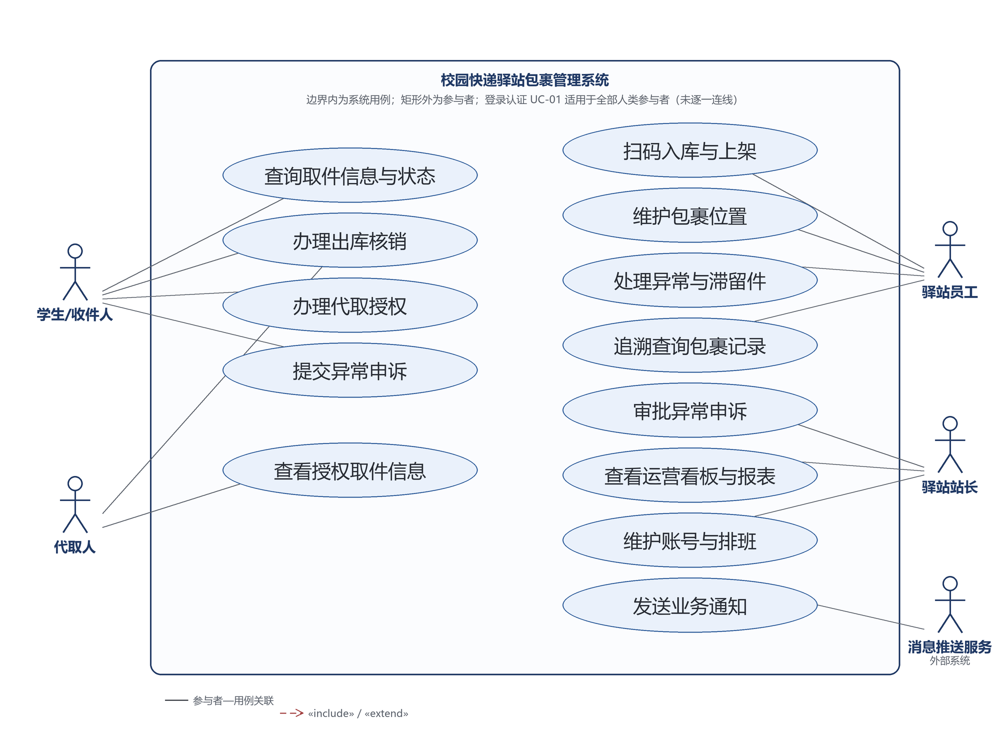
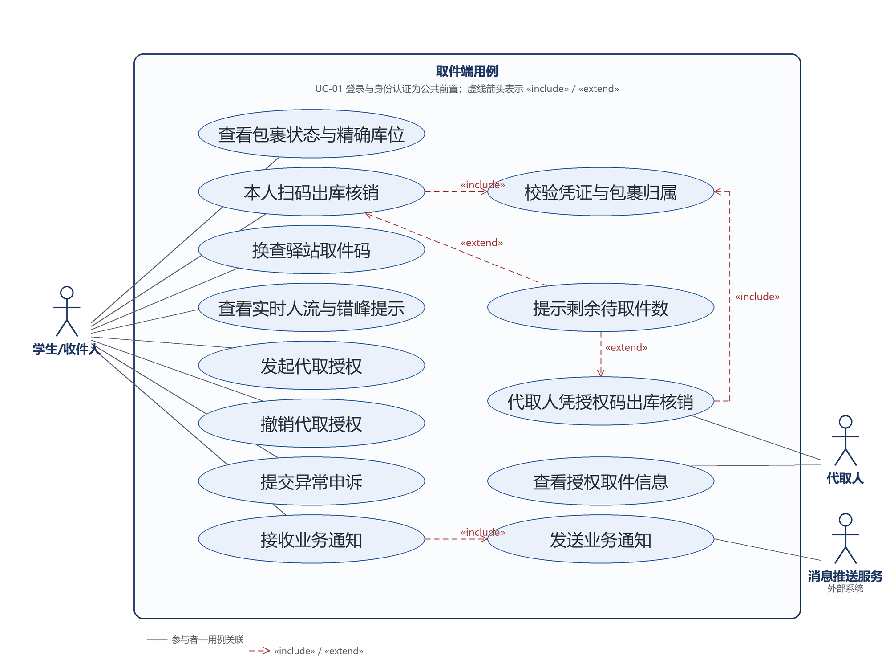
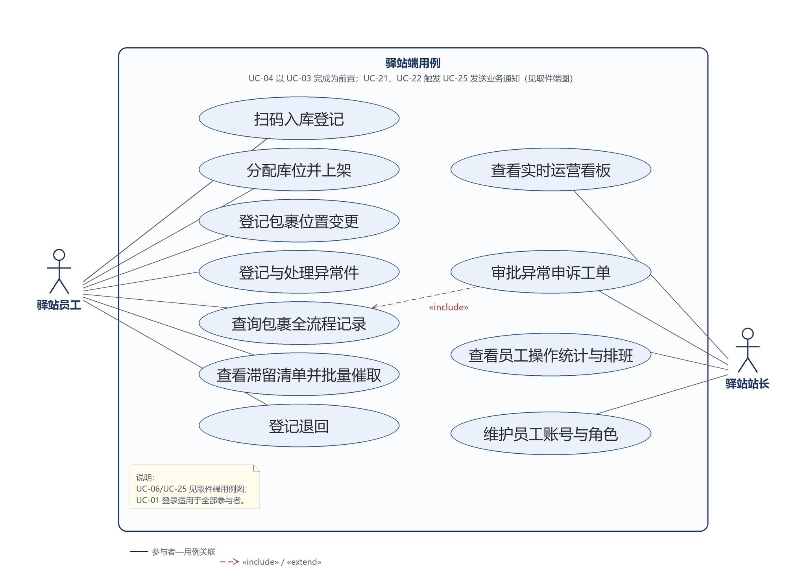

# 校园快递驿站包裹管理系统

## 用例图（Use Case Diagram）

> 文档版本：v0.1（初稿）　|　日期：2026-11-27　|　配套文档：《需求规格说明书（SRS）》v0.1

| 项目 | 内容 |
|---|---|
| 课程名称 | 软件工程课程设计 |
| 项目名称 | 校园快递驿站包裹管理系统 |
| 文档名称 | 用例图与用例清单 |
| 文档编号 | SECourseDesign2026-UC-001 |
| 版本 | v0.1（初稿） |
| 编制 | 课程设计小组 |
| 日期 | 2026-11-27 |
| 说明 | 本文件给出系统用例图、参与者、用例清单与用例关系；详细用例描述与功能需求见 SRS 第 3、4 章 |

## 1 图形约定

本组图采用 UML 用例图表示法：

- **参与者（Actor）**：火柴人，位于系统边界之外，表示与系统交互的人或外部系统。
- **用例（Use Case）**：椭圆，位于系统边界之内，表示系统为参与者提供的一项完整功能。
- **系统边界**：圆角矩形，标注系统名称，界定系统的职责范围。
- **关联（Association）**：实线，连接参与者与其参与的用例。
- **包含（«include»）**：虚线箭头，表示源用例在执行中必然使用目标用例。
- **扩展（«extend»）**：虚线箭头，表示在特定条件下为目标用例增加行为。

图 3-1 为系统级总览，图 3-2 与图 3-3 分别给出取件端与驿站端的细化视图。三张图覆盖《需求规格说明书（SRS）》表 3-2 的全部 25 个用例，其中图 3-1 为粗粒度归纳；图中未逐一绘制"登录认证（UC-01）"的关联线，统一以图内说明标注。

## 2 参与者

表 2-1 参与者清单

| 编号 | 参与者 | 类型 | 说明 |
|---|---|---|---|
| PA-01 | 学生/收件人 | 主要参与者 | 包裹的合法收件人，使用取件查询、出库核销、代取授权、异常申诉等功能 |
| PA-02 | 代取人 | 主要参与者 | 接受收件人授权代为取件的校内人员，仅能查看被授权包裹的最小信息并完成核销 |
| PA-03 | 驿站员工 | 主要参与者 | 负责入库、上架、移位、包裹查询、异常登记、滞留催取与退回登记 |
| PA-04 | 驿站站长 | 主要参与者 | 负责申诉审批、退回确认、运营看板、员工统计与账号管理 |
| PA-05 | 消息推送服务 | 外部系统 | 微信公众号模板消息/短信网关，负责通知发送与送达状态回传 |

## 3 用例图

### 3.1 系统用例总图

*图 3-1 系统用例总图*

图 3-1 以粗粒度用例概括五类参与者与系统的交互。粗粒度用例与细化用例的对应关系如下：

- 查询取件信息与状态 → UC-06、UC-07、UC-08、UC-09
- 办理出库核销 → UC-10、UC-11、UC-12、UC-13
- 办理代取授权 → UC-14、UC-15、UC-16
- 提交异常申诉 → UC-17
- 扫码入库与上架 → UC-03、UC-04
- 维护包裹位置 → UC-05
- 处理异常与滞留件 → UC-18、UC-21、UC-22
- 追溯查询包裹记录 → UC-19
- 审批异常申诉 → UC-20
- 查看运营看板与报表 → UC-23、UC-24
- 维护账号与排班 → UC-02、UC-24
- 发送业务通知 → UC-25

### 3.2 取件端用例图

*图 3-2 取件端用例图（学生/收件人、代取人）*

图 3-2 突出取件端的关键关系：

- **核销前必须校验归属**：本人核销（UC-10）与代取核销（UC-11）都 `«include»` 校验凭证与包裹归属（UC-12），校验失败时包裹保持在库。
- **剩余件数提示是扩展行为**：核销成功后按条件 `«extend»` 提示剩余待取件数（UC-13），用于多件取件场景。
- **通知的展示与发送分离**：接收业务通知（UC-06）`«include»` 发送业务通知（UC-25），使通知发送、重试与送达状态可独立记录。
- **代取信息最小披露**：代取人只能进入查看授权取件信息（UC-16）与代取核销（UC-11），不暴露购买内容。

### 3.3 驿站端用例图

*图 3-3 驿站端用例图（驿站员工、站长）*

图 3-3 的说明：

- **入库与上架分离但连续**：扫码入库登记（UC-03）完成到件登记与取件码生成；分配库位并上架（UC-04）完成库位/大件暂存位绑定，并以 UC-03 为前置。
- **位置变更贯穿在库周期**：登记包裹位置变更（UC-05）在移位、滞留区转移与上架修正时保持取件端与实物一致。
- **异常与滞留闭环**：登记与处理异常件（UC-18）形成处理台账；查看滞留清单并批量催取（UC-21）与登记退回（UC-22）在动作中触发 UC-25 发送通知（见取件端图）。
- **审批依据完整记录**：站长审批异常申诉工单（UC-20）`«include»` 查询包裹全流程记录（UC-19），确保责任认定基于入库、移位、出库、通知的完整证据链。

## 4 用例清单

表 4-1 用例清单（25 个）

| 编号 | 用例名称 | 主要参与者 | 关联功能需求 | 优先级 | 增量 |
|---|---|---|---|---|---|
| UC-01 | 登录与身份认证 | 全部人类参与者 | FR-01 | P0 | 1 |
| UC-02 | 维护员工账号与角色 | 驿站站长 | FR-02 | P0 | 1 |
| UC-03 | 扫码入库登记 | 驿站员工 | FR-03 | P0 | 1 |
| UC-04 | 分配库位并上架 | 驿站员工 | FR-04 | P0 | 1 |
| UC-05 | 登记包裹位置变更 | 驿站员工 | FR-05 | P0 | 1 |
| UC-06 | 接收业务通知 | 学生、消息推送服务 | FR-06、FR-18、FR-24 | P0 | 1 |
| UC-07 | 查看包裹状态与精确库位 | 学生 | FR-07、FR-08 | P0 | 1 |
| UC-08 | 换查驿站取件码 | 学生 | FR-09 | P1 | 3 |
| UC-09 | 查看实时人流与错峰提示 | 学生 | FR-10 | P2 | 3 |
| UC-10 | 本人扫码出库核销 | 学生 | FR-11、FR-12、FR-13 | P0 | 2 |
| UC-11 | 代取人凭授权码出库核销 | 代取人 | FR-16、FR-12、FR-13 | P0 | 2 |
| UC-12 | 校验凭证与包裹归属 | 学生、代取人（被包含） | FR-11、FR-16 | P0 | 2 |
| UC-13 | 提示剩余待取件数 | 学生、代取人（扩展） | FR-12 | P1 | 2 |
| UC-14 | 发起代取授权 | 学生 | FR-14 | P0 | 2 |
| UC-15 | 撤销代取授权 | 学生 | FR-15 | P0 | 2 |
| UC-16 | 查看授权取件信息 | 代取人 | FR-17 | P1 | 2 |
| UC-17 | 提交异常申诉 | 学生 | FR-19 | P0 | 3 |
| UC-18 | 登记与处理异常件 | 驿站员工 | FR-20 | P0 | 3 |
| UC-19 | 查询包裹全流程记录 | 驿站员工 | FR-21 | P0 | 1 |
| UC-20 | 审批异常申诉工单 | 驿站站长 | FR-22 | P1 | 3 |
| UC-21 | 查看滞留清单并批量催取 | 驿站员工 | FR-23 | P0 | 3 |
| UC-22 | 登记退回 | 驿站员工、驿站站长 | FR-24 | P1 | 3 |
| UC-23 | 查看实时运营看板 | 驿站站长 | FR-25 | P1 | 3 |
| UC-24 | 查看员工操作统计与排班 | 驿站站长 | FR-26 | P2 | 3 |
| UC-25 | 发送业务通知 | 消息推送服务 | FR-06、FR-18、FR-24 | P0 | 1 |

## 5 用例关系

表 5-1 用例关系（«include» / «extend»）

| 编号 | 源用例 | 关系 | 目标用例 | 说明 |
|---|---|---|---|---|
| REL-01 | UC-10 本人扫码出库核销 | «include» | UC-12 校验凭证与包裹归属 | 核销前必须完成归属校验，失败则保持在库 |
| REL-02 | UC-11 代取人凭授权码出库核销 | «include» | UC-12 校验凭证与包裹归属 | 代取核销同样执行归属与授权状态校验 |
| REL-03 | UC-13 提示剩余待取件数 | «extend» | UC-10 本人扫码出库核销 | 核销成功后按条件扩展剩余件数提示 |
| REL-04 | UC-13 提示剩余待取件数 | «extend» | UC-11 代取人凭授权码出库核销 | 代取场景同样适用剩余件数提示 |
| REL-05 | UC-06 接收业务通知 | «include» | UC-25 发送业务通知 | 通知展示依赖发送与送达记录 |
| REL-06 | UC-21 查看滞留清单并批量催取 | «include» | UC-25 发送业务通知 | 批量催取需发送通知并记录结果（跨图） |
| REL-07 | UC-22 登记退回 | «include» | UC-25 发送业务通知 | 退回后通知收件人原因与承运方（跨图） |
| REL-08 | UC-20 审批异常申诉工单 | «include» | UC-19 查询包裹全流程记录 | 审批需依据入库、移位、出库、通知等完整记录 |

> REL-06、REL-07 的目标用例 UC-25 绘制在图 3-2 中；图 3-3 以图内说明标注该跨图关系，避免重复绘制外部系统。

## 6 与 SRS 的一致性

- 本文件的 25 个用例、参与者与关系表与《需求规格说明书（SRS）》表 3-2、表 3-3 一致。
- 图 3-1 为粗粒度总览，其元素是表 4-1 中用例的归纳，不新增需求；图 3-2、图 3-3 为细化视图，覆盖表 4-1 的全部用例。
- 用例的详细描述见 SRS 3.5 节（12 个核心用例）；其余用例的规格以 SRS 表 3-2 与第 4 章对应功能需求为准。
- 后续若调整用例，需同步更新：本文件第 3—5 节、SRS 表 3-2/3-3、功能需求追踪矩阵（SRS 表 8-1）以及三张 PNG 图。

## 7 图的维护说明

- 图形文件位于 `docs/design/diagrams/`，文件名与图号一致：`图3-1_系统用例总图.png`、`图3-2_取件端用例图.png`、`图3-3_驿站端用例图.png`。
- 当前 PNG 为 2000×1460/1500 像素、300 dpi，嵌入 A4 文档时按 16 cm 宽度排版，文字约 9 pt，可直接打印。
- 修改图形时，请保持"参与者—用例—关系"与表 4-1、表 5-1 同步；若新增用例，需在 SRS 中补充对应功能需求与追踪关系。
