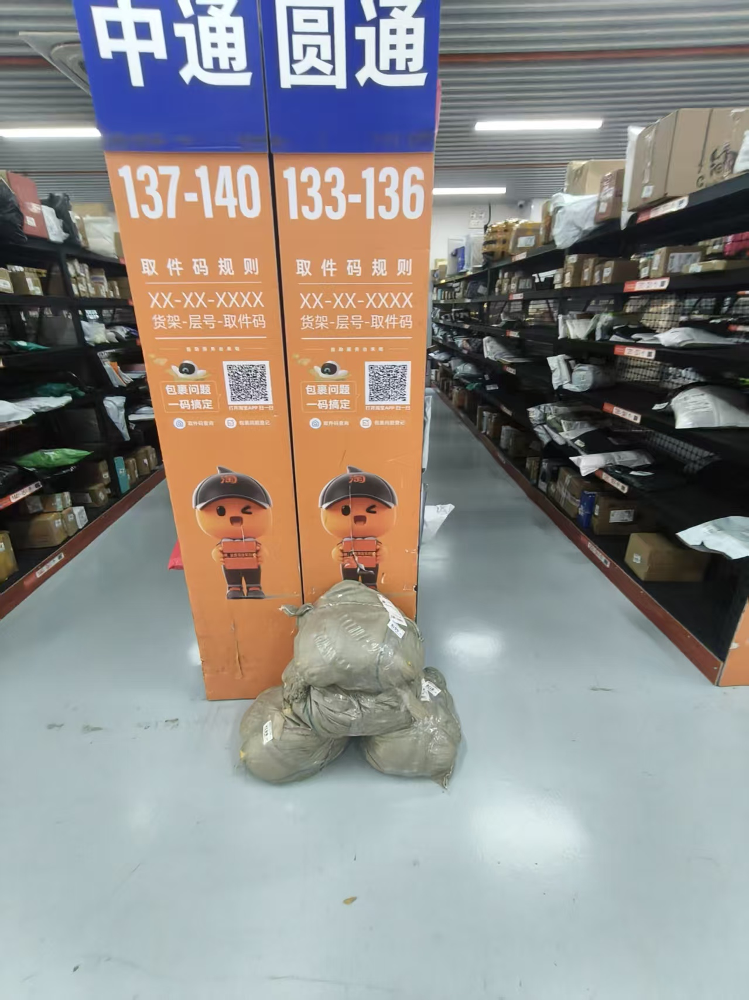
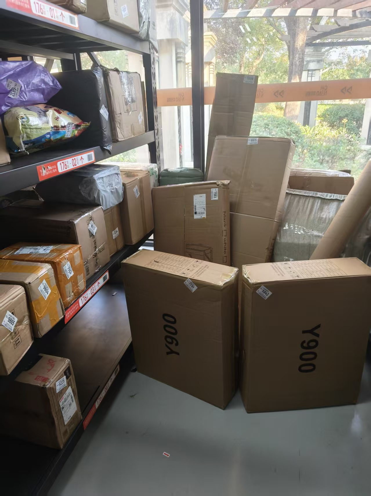
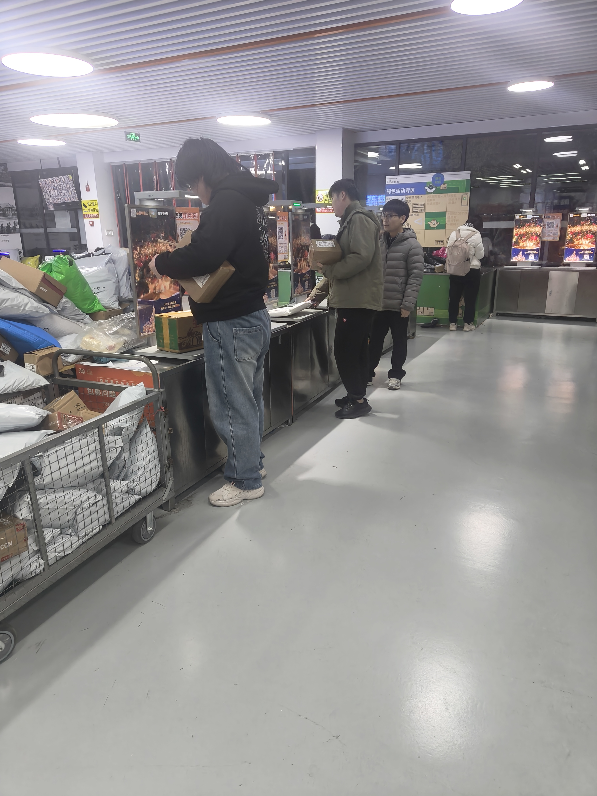
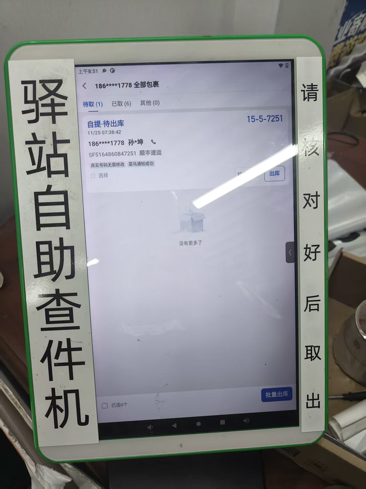

## “校园快递驿站管理系统”学生访谈

### 一、访谈提纲

**访谈对象**：本校使用校园快递驿站的学生。围绕位学生的经历，了解本人取件、请人代取和帮人取件的情况。  
**访谈时长**：预计20-30分钟  
**访谈方式**：拟采用面对面半结构化访谈，1人主问、1人记录  
**访谈目的**：了解学生从收到通知到拿到包裹的实际经过，找出哪些步骤需要额外确认、等待或求助。

#### 模块1：日常取件与到站通知

1. 你一般会挑什么时候去驿站？
2. 最近一次取件，你是怎么知道包裹可以拿了的？
3. 到站之前，你会先看通知里的哪些信息？

#### 模块2：进站找件

4. 就说上次那件，进门以后你是怎么找到它的？
5. 有没有哪次按提示走到货架旁，还是没看到包裹？
6. 那次你后来是在哪儿找到的？

#### 模块3：核对包裹与出库

7. 从架子上拿起包裹时，你怎么确认是自己的？
8. 到了出口，你怎么知道这件已经扫好了？
9. 如果一次拿了好几件，你怎么确认每一件都办好了？

#### 模块4：顺路帮忙取件

10. 最近一次你和同学互相帮忙拿快递，是怎么约好的？
11. 出门前，你们怎么说清楚要拿哪一件？
12. 到了出口，那次实际是怎么完成核验的？
13. 包裹取出来以后，你们怎么确认已经交到对方手里？

**追问**：如果是你请别人取，你愿意发给对方哪些信息？有没有什么需要先说清楚？没有代取经历的同学可以跳过本组。

#### 模块5：异常与高峰体验

14. 有没有遇到过哪件快递需要到前台问？当时你在手机上看到了什么？
15. 回想最近一次驿站人多的时候，你在哪一步等得最久？
16. 当天来不及取时，你怎么安排？后来怎么知道包裹是否还在站里？
17. 有没有取错快递或者被取错的经历，后来怎么解决的呢？

#### 模块6：改进期望与结束

18. 如果先改一个地方，你希望下次来取件时哪一步更省事？

19. 怎样的变化会让你觉得这个问题真的解决了？

20. 还有什么是我们刚才没问到、但你取件时很在意的？

### 二、访谈记录

**访谈对象**：学生甲  
**访谈时间、地点**：同济大学菜鸟驿站附近 
**访谈方式**：面对面访谈  
**访谈目的**：从学生视角了解自己取件及同学间代取的经过。

**问：你最近一次去驿站取快递是怎么想起来去拿快递的，一般什么时候去呢？**

答：前一天收到了取件码短信，然后一般下课或者吃完饭的时候我就在菜鸟app上看取件码，然后顺路去驿站把快递取了。

**问：进门以后，你怎么定位到去哪里找自己的快递？**

答：我在菜鸟app或者短信上看取件码，然后现在这个驿站还算方便，货架指引还是挺清晰的，取件码格式就是货架编号--某层的编号--某层中的四位取件号，然后货架也是按编号顺序从小到大排好号的，也能比较容易找。找到取件码上的货架和层数之后再按四位取件号去一个一个找嘛，就是这里会比较麻烦，这个一般没啥顺序，就乱摆着的，有时候要找半天。找到之后一般我会再确认一下面单号，确认一下是自己的，拿错的话还挺麻烦的。

**问：有没有到了那排架子，还是找不到的时候？**

答：有啊，之前买的床垫就是。我跟平常一样去架子上找，找了半天来来回回看几遍都没看到，最后去问前台的工作人员。后面工作人员问了我取件码他查了之后问我是不是大件，我说是的，然后他直接带我去旁边地上乱堆着的大件堆中去找了，我进来的时候瞥到了的，但是完全没往那边去想啊。还有几次确实是他架子上每一层摆得比较乱，我实在没找到在哪，有时候可能就被其他快件给挡住了，最后工作人员来帮我找才找到。还有之前有一次是因为是放太久了吧，我也是找了好久找不到，最后才知道是因为滞留太久被收到其他地方去了。

**问：拿到件以后，到哪一步你才觉得可以走了？特别是如果一次取了多件的时候呢？**

答：出口那里有自助出库机，扫一下快递上的面单和自己的身份码，然后机器提示出库成功，如果要取很多快递的话，一般如果还有包裹没出库的话机器会说剩几件包裹，没有剩余包裹的时候，就取完快递可以走了。这个提示有几件没取的却是还挺实用的。但是其实他出库机扫的那个身份码只是确定是被谁取走了，没法把快递和收件人完全对应上，还是会有取错的风险，这点我觉得还可以改改，我之前就取错过的哈哈哈。

**问：你刚说一般下课顺路去。有过顺手帮同学带一件的时候吗，流程是怎么样的呢？**

答：有。之前帮室友取过几次，一般都是他直接给我发取件码截图或者转发那个取件的短信给我，但是我就不像平时取自己快递会去自助出库机上出库了，我就直接拿着就走了。

**问：那如果你代取的话，你室友怎么知道他的包裹已经被取走了的？**

答：我一般直接给他发消息说拿到了，有时候会给他拍个面单的照片确认一下，有时候他不及时回消息的话我也不知道到底有没有拿错，我也确定不了，只能拿回去他看到了才能确定，这点还挺不好的吧，但是我目前帮他取快递好像没有拿错过吧。

**问：反过来，如果是你请他帮忙拿，你会怎么做？**

答：我之前试过菜鸟app那个找人代取的功能，我以为他是可以直接分享给对方一个链接什么的，然后相当于他也可以帮我去出库什么的，但是好像最后就也是生成一个类似取件码截图的链接吧，感觉没有很实用。我一般还是直接发取件码或者截图吧，有时候我会附上具体是什么东西，来帮他更容易去确认包裹吧，但是有时候我又不想透露到底买的什么东西，就只是发个取件码，总之还是有点为难的，我希望这个功能可以做得更好一点，能兼顾安全性、便利性和隐私性吧。

**问：除了找大件床垫那回，还有什么情况让你专门去问过前台？**

答：有时候顺丰的快递他不发具体的取件码的，就只给你发一个四位数字，我就不知道去哪里找，就只能去前台去问，让工作人员查出来之后我记录一下具体的取件码再去找，但是好像现在能用那个自助查询机去查吧，但感觉还是不太方便。曾经还有时候，但我记不清是现在这个驿站还是之前那个了，就是很奇怪啊，我明明收到取件码了都，但是去了驿站找半天都没找到，去前台问了工作人员查询之后才发现包裹刚到驿站，还没上架，还在地上乱摆着的，只能等工作人员去上架完或者等他一个一个去找到才能取，这个我觉得挺烦的。

**问：以你一次取快递的经历来看，时间主要花在哪儿了？**

答：如果正常的话，一切都顺利的话，那应该就是在具体的货架上按照四位编号去找我的快递最费时吧。人多一点的时候可能在出库机那里需要排一下队，要不遇到问题的话，特别是我刚刚说的那个以为已经上架了但是还没上架的情况，就是等工作人员的这个过程需要费不少时间吧，他们很多时候又在忙，就只能等他们忙完手头的事才能来帮我解决我的问题。

**问：你之前有提到过快递放了很久没去取的情况，一般会收到提醒吗？**

答：一般几天没取的话驿站工作人员会打电话过来确认你什么时候会来取的，如果长时间不取的话好像是会被退回或者存放在滞留区的。

**问：有没有取错快递或者被取错的经历，最后怎么解决的？**

答：我自己没有遇到过。但是我的室友之前遇到过一次，他妈妈当时给他买了一件饮料吧，他找到那层货架上好像很多都是饮料的快件，他当时没看清数字，就拿错了，拿自己的身份码出库了，也能成功出库，回到寝室后因为都是饮料嘛，也没发现取错了，后来应该是被取错的同学找到驿站了，驿站的工作人员应该通过那个身份码确认到我的室友取错了，然后给他打电话，后来因为已经被拆开也喝了几瓶了，那个同学也不想要了，就赔了他这件饮料的钱，我觉得这个事情对双方都挺不愉快的吧，还折腾了一两天，本来如果能把身份码对应到这个快递的主人这样就最好了。

**问：如果能改进一些，你希望改什么？**

答：一是我觉得具体的哪个货架的哪一层已经比较清晰了，但是在这一层的具体哪个位置的这四位数字我觉得还不足以很清晰的刻画这个包裹的位置，因为感觉都是随便堆在一起的，有时候也比较乱，还是要找很久，没有具体的顺序。二是我觉得身份码出库的这个功能是不是可以优化一下，我觉得如果能用主人码取件的话是不是更安全，就是说给这个快件的真正主人分配一个二维码，然后用这个二维码才能成功取件，应该就像这样吧。还有最后一个我觉得就是那些大件的位置可以清晰一点，比如专门设置一个大件摆放区，不然没有经验的话真的容易忽略掉吧，然后找半天都找不到。

**附：访谈中反映的核心需求痛点（供需求分析使用）**

| 核心痛点 | 访谈依据 | 对应的系统需求方向 |
|---|---|---|
| 找得到货架和层数，到了那一层仍要逐件翻找 | 学生甲认为货架指引清晰，但同层包裹没有明显顺序，有些标签被其他包裹挡住。正常取件时，按四位取件号找出实物是最费时的一步。 | 取件页显示与现场标识一致的位置。可与上架员工试行层内分区，确认能否缩短找件时间，以及是否增加上架负担。 |
| 大件和移位件的实际位置难以判断 | 学生甲拿床垫时按码反复找架，最后由员工带到地面大件区；另一次包裹久未领取，移走后仍按原位置寻找。工作人员也提到大件临时摆放、滞留件需人工盘点。 | 上架时记录大件的实际暂存位置。包裹移入滞留区或其他位置时，同步更新取件页，并保留移位时间和去向。 |
| 到站消息未必足以让学生直接取件 | 学生甲提到，部分顺丰件只收到四位数字，还需另查驿站取件码。另有一次收到码时包裹尚未上架，但受访者记不清是否发生在本站。 | 区分“已到站”和“已上架可取”。上架后推送站内取件码和实际库位；学生只收到快递方通知时，提供站内查件指引。 |
| 高峰时，自助出库和人工查件都有等待 | 学生甲提到人多时会在出库机前排队；位置不符时，还要等正在忙的员工抽身。工作人员也反映，入库、找件和咨询经常同时发生。 | 支持学生自助查看包裹状态和最新库位，减少在前台等人查件的时间。核对位置后仍找不到包裹时，可转入已有的异常件处理流程。 |
| 扫码成功后，仍可能带走别人的包裹 | 学生甲认可机器提示剩余待取件数，也转述了室友拿错同层饮料、用自己的身份码成功出库的经历。发现时饮料已拆开，双方还需协调赔偿。 | 出库前按单校验取件权限：收件人本人或获得该件授权的代取人可以核销。凭证与包裹不匹配时，提示重新核对，包裹保持在库。学生认可的剩余件数提示可予保留。 |
| 代取靠截图和聊天确认，包裹、授权与出库记录容易脱节 | 学生甲帮室友取件时凭截图找件，曾直接带走而未扫码；随后靠消息或面单照片确认。自己委托代取时，又不愿为了辨认包裹而透露购买内容。 | 收件人按包裹发起授权，代取人凭限时取件码办理出库。仅展示找件和核验所需的信息；核销成功后通知收件人该件已由代取人取走。 |
| 错取或漏扫后，员工需要核对多处记录、联系当事人才能还原经过 | 学生甲转述的错取案例涉及驿站联系取件人和双方协商。工作人员访谈补充，漏扫会使实物与在库状态不符，事后常需查记录、调监控、联系当事人。 | 按包裹关联入库、移位和出库记录。员工处理错取或漏扫申诉时，可查看相关操作，记录经办人、联系进展和处理结果。 |

### 三、现场调研照片

图一 货架照片及取件码规则示例

图二 大件堆放位置图

图三 自助出库机出库示意图

图四 自助查询机查询包裹示意图

