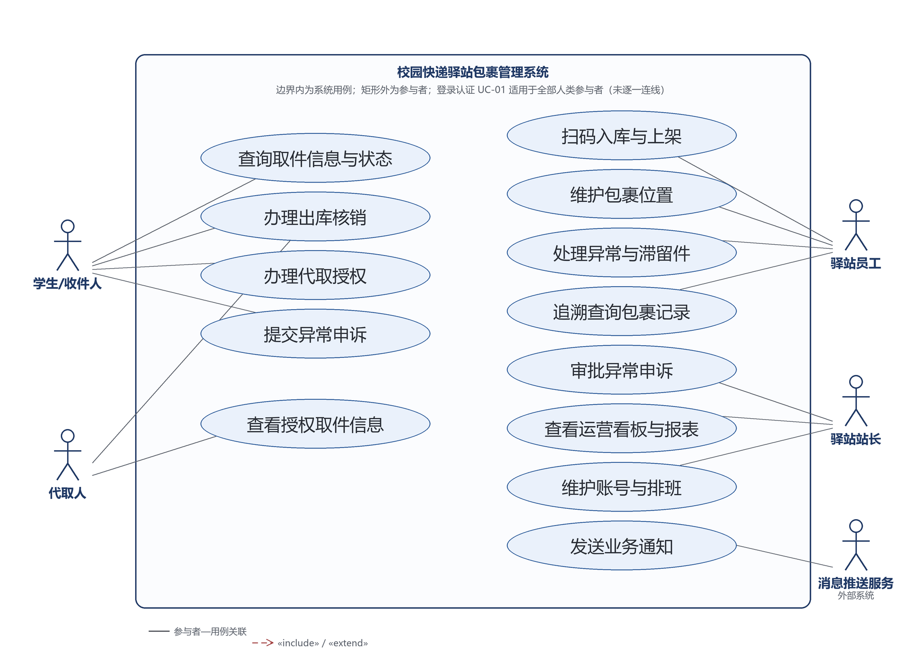
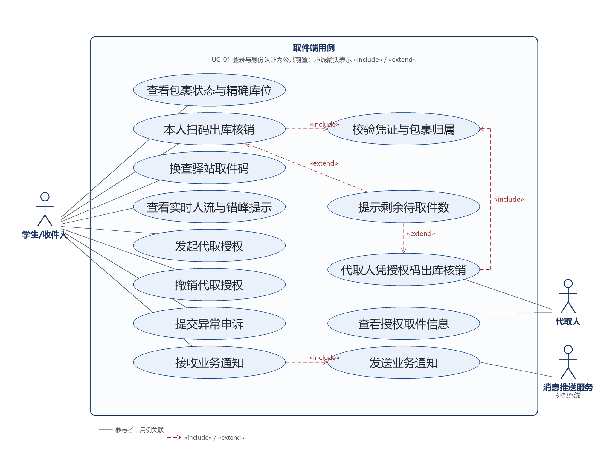
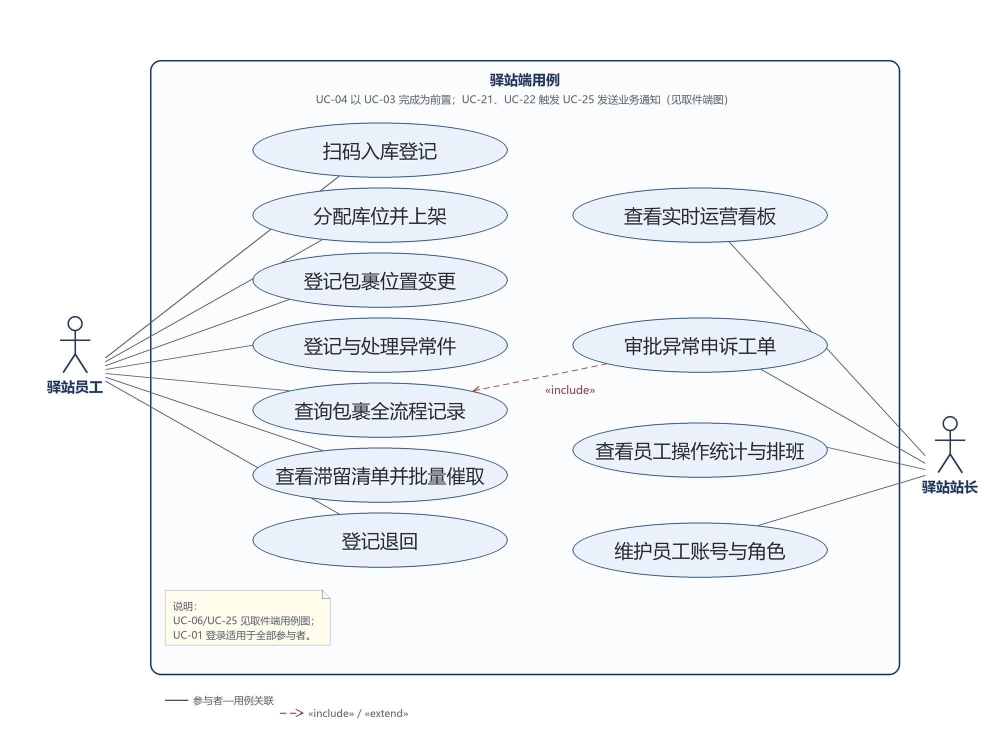

# 校园快递驿站包裹管理系统

## 需求规格说明书（SRS）

> 文档版本：v0.1（初稿）　|　文档编号：SECourseDesign2026-SRS-001　|　编制：课程设计小组　|　日期：2026-11-27

| 项目 | 内容 |
|---|---|
| 课程名称 | 软件工程课程设计 |
| 项目名称 | 校园快递驿站包裹管理系统（Campus Parcel Station Management System） |
| 文档名称 | 需求规格说明书（Software Requirements Specification，SRS） |
| 文档编号 | SECourseDesign2026-SRS-001 |
| 版本 | v0.1（初稿，待评审） |
| 编制 | 课程设计小组 |
| 完成日期 | 2026-11-27 |
| 依据文档 | 《需求调研报告》v0.1、《用户故事清单》v1.0、访谈记录、问卷原始数据 |

## 修订记录

| 版本 | 日期 | 修订内容 | 修订人 |
|---|---|---|---|
| v0.1 | 2026-11-27 | 依据需求调研报告、用户故事清单与问卷原始数据，建立用例模型（25 个用例、3 张用例图），编写功能需求、非功能需求、数据与接口需求及追踪矩阵初稿 | 课程设计小组 |

## 目录

- [校园快递驿站包裹管理系统](#校园快递驿站包裹管理系统)
  - [需求规格说明书（SRS）](#需求规格说明书srs)
  - [修订记录](#修订记录)
  - [目录](#目录)
  - [1 引言](#1-引言)
    - [1.1 编写目的](#11-编写目的)
    - [1.2 项目背景与产品定位](#12-项目背景与产品定位)
    - [1.3 系统范围与边界](#13-系统范围与边界)
    - [1.4 术语与缩略语](#14-术语与缩略语)
    - [1.5 参考资料](#15-参考资料)
    - [1.6 文档约定](#16-文档约定)
  - [2 总体描述](#2-总体描述)
    - [2.1 产品愿景与成功度量](#21-产品愿景与成功度量)
    - [2.2 用户角色与特征](#22-用户角色与特征)
    - [2.3 运行环境](#23-运行环境)
    - [2.4 设计与实现约束](#24-设计与实现约束)
    - [2.5 假设与依赖](#25-假设与依赖)
    - [2.6 需求优先级与增量映射](#26-需求优先级与增量映射)
  - [3 用例模型](#3-用例模型)
    - [3.1 参与者](#31-参与者)
    - [3.2 用例清单](#32-用例清单)
    - [3.3 用例图](#33-用例图)
    - [3.4 用例关系](#34-用例关系)
    - [3.5 核心用例描述](#35-核心用例描述)
      - [3.5.1 UC-01 登录与身份认证](#351-uc-01-登录与身份认证)
      - [3.5.2 UC-03 扫码入库登记](#352-uc-03-扫码入库登记)
      - [3.5.3 UC-04 分配库位并上架](#353-uc-04-分配库位并上架)
      - [3.5.4 UC-05 登记包裹位置变更](#354-uc-05-登记包裹位置变更)
      - [3.5.5 UC-07 查看包裹状态与精确库位](#355-uc-07-查看包裹状态与精确库位)
      - [3.5.6 UC-10 本人扫码出库核销](#356-uc-10-本人扫码出库核销)
      - [3.5.7 UC-11 代取人凭授权码出库核销](#357-uc-11-代取人凭授权码出库核销)
      - [3.5.8 UC-14 发起代取授权](#358-uc-14-发起代取授权)
      - [3.5.9 UC-15 撤销代取授权](#359-uc-15-撤销代取授权)
      - [3.5.10 UC-17 提交异常申诉](#3510-uc-17-提交异常申诉)
      - [3.5.11 UC-21 查看滞留清单并批量催取](#3511-uc-21-查看滞留清单并批量催取)
      - [3.5.12 UC-23 查看实时运营看板](#3512-uc-23-查看实时运营看板)
  - [4 功能需求](#4-功能需求)
    - [4.1 功能需求清单](#41-功能需求清单)
    - [4.2 功能需求详细说明](#42-功能需求详细说明)
      - [4.2.1 F1 账号与权限](#421-f1-账号与权限)
      - [4.2.2 F2 入库与库位](#422-f2-入库与库位)
      - [4.2.3 F3 通知与取件查询](#423-f3-通知与取件查询)
      - [4.2.4 F4 出库核销](#424-f4-出库核销)
      - [4.2.5 F5 代取授权](#425-f5-代取授权)
      - [4.2.6 F6 异常与追溯](#426-f6-异常与追溯)
      - [4.2.7 F7 滞留与退回](#427-f7-滞留与退回)
      - [4.2.8 F8 看板与报表](#428-f8-看板与报表)
    - [4.3 业务规则](#43-业务规则)
    - [4.4 包裹状态与流转约束](#44-包裹状态与流转约束)
  - [5 非功能需求](#5-非功能需求)
    - [5.1 非功能需求清单](#51-非功能需求清单)
    - [5.2 性能与容量](#52-性能与容量)
    - [5.3 安全与隐私](#53-安全与隐私)
    - [5.4 可靠性与一致性](#54-可靠性与一致性)
    - [5.5 易用性、可维护性与兼容性](#55-易用性可维护性与兼容性)
  - [6 数据需求](#6-数据需求)
    - [6.1 概念数据模型](#61-概念数据模型)
    - [6.2 数据实体](#62-数据实体)
    - [6.3 数据保留、归档与销毁](#63-数据保留归档与销毁)
    - [6.4 数据质量与一致性](#64-数据质量与一致性)
  - [7 外部接口需求](#7-外部接口需求)
    - [7.1 用户界面](#71-用户界面)
    - [7.2 硬件接口](#72-硬件接口)
    - [7.3 软件接口](#73-软件接口)
    - [7.4 通信接口](#74-通信接口)
  - [8 验收与需求追踪](#8-验收与需求追踪)
    - [8.1 验收准则](#81-验收准则)
    - [8.2 需求追踪矩阵](#82-需求追踪矩阵)
    - [8.3 覆盖性与一致性检查](#83-覆盖性与一致性检查)
  - [9 假设、依赖与待确认问题](#9-假设依赖与待确认问题)
    - [9.1 假设](#91-假设)
    - [9.2 依赖](#92-依赖)
    - [9.3 待确认问题](#93-待确认问题)
    - [9.4 后续工作](#94-后续工作)
  - [附录 A 调研证据索引](#附录-a-调研证据索引)
  - [附录 B 需求变更与评审记录](#附录-b-需求变更与评审记录)

## 1 引言

### 1.1 编写目的

本文档依据《需求调研报告》与《用户故事清单》，在已完成的需求调研结论之上建立系统的用例模型，并给出功能需求、非功能需求、数据需求与外部接口需求的初稿，作为后续概要设计、数据库设计、接口设计、测试用例编写与增量验收的共同基线。

本文档的预期读者包括：课程设计小组全体成员、指导教师与课程评审人员、驿站工作人员代表（用于确认业务流程与可操作性），以及后续承担详细设计、开发与测试的同学。

本文档为**初稿**：需求条目已覆盖调研形成的 22 条功能类用户故事与 4 条非功能类用户故事，但第三章至第七章中标注"待确认"的内容需在评审与现场复核后定稿（见第 9 章）。

### 1.2 项目背景与产品定位

校园快递驿站承担包裹到站后的暂存与交付，是高校师生高频使用的服务点。调研显示（问卷原始导出，56 份有效样本）：82.14% 的学生每月取件 3 次及以上；取件集中在晚间（57.14%）与傍晚课后（51.79%）；39.29% 的学生在高峰需要排队 5 分钟以上；57.14% 的学生可在 3 分钟内找到包裹，但仍有 23.21% 反映"包裹堆放混乱、不在编号位置"、21.43% 反映"缺少找件指引"。

驿站侧的现实约束同样明显：日均处理约 1000 件、开学季高峰超过 2000 件，平时 4—5 人轮班；小件从扫码到上架约十余秒，而大件受货架层高、承重与站内空间限制只能放在大件暂存区、地面或通道边，系统记录的货架号常与实际位置不符（W1、O2、O6）。出库环节依赖自助出库机扫面单与身份码，但身份码只记录"被谁取走"，无法校验包裹归属，存在错取与"系统显示在库、实物已取走"的漏扫风险（S5、W3、O3）。

本项目定位为面向单站点的轻量级微型仓储管理系统（Mini-WMS），聚焦包裹"到件之后"的入库、上架与库位绑定、通知、找件、出库核销、代取授权、异常与滞留处理以及运营看板，不涉及上游快递公司的揽收与干线运输，也不涉及支付交易。

### 1.3 系统范围与边界

表 1-1 系统范围与边界

| 类别 | 范围说明 |
|---|---|
| 系统负责范围 | 包裹到站登记、入库扫码、库位/大件暂存位绑定、位置变更登记、到件与上架通知、取件信息查询、出库核销与归属校验、多件剩余提示、代取授权与撤销、异常件申诉与处理台账、滞留清单与催取退回、运营看板与员工统计、账号与权限、审计留痕 |
| 系统不负责范围 | 上游快递公司的揽收、干线运输与末端派送；支付、退款与赔付的资金流；商品交易与售后；快递公司面单系统改造；货架等物理设施改造；员工现场排班的执行（首期仅提供排班表维护与导出，见 U-07）；跨驿站多租户运营（首期单站点，接口预留） |
| 系统边界说明 | 系统只生成并管理站内取件码与取件凭证，不替代快递公司运单；通知依赖微信公众号模板消息或短信网关等外部服务；系统不提供室内地图导航，仅提供与现场标识一致的库位文字指引 |
| 与上游/下游的衔接 | 上游：快递员卸车、粗分后由员工扫码入库；下游：收件人或代取人在自助出库机/员工端完成核销；异常与退回通过承运方线下交接，系统仅登记结果 |

### 1.4 术语与缩略语

表 1-2 术语与缩略语

| 术语/缩略语 | 说明 |
|---|---|
| 包裹（Parcel） | 到达驿站、等待交付给收件人的快件，是系统的核心业务对象 |
| 运单号 | 快递公司分配的运单标识，全局唯一，用于入库与查询 |
| 取件码 | 驿站生成的站内取件凭证，由货架号、层号与四位序号等构成（编码规则见 U-02） |
| 库位 | 包裹在驿站内的实际存放位置，包括货架库位与大件暂存位 |
| 大件暂存位 | 因层高、承重或体积无法上架的大件所使用的地面/通道旁编码位置，如"大件区·地面-01" |
| 上架 | 将已入库包裹放置到库位并完成系统绑定的作业 |
| 滞留 | 超过站点规定免费保管期仍未取走的包裹 |
| 临期 | 距离免费保管期结束不足设定阈值的包裹状态 |
| 核销 | 校验取件凭证与包裹归属后完成出库并写入出库记录的操作 |
| 代取授权 | 收件人按包裹签发、允许指定代取人取件的限时凭证 |
| 动态授权码 | 代取授权对应的、有时效且单次有效的取件码/核销码 |
| 最小披露 | 仅向代取人展示找件与核验必需的字段，不展示商品明细 |
| 幂等 | 同一请求重复提交只产生一次业务效果，本系统特指同一包裹不重复出库 |
| 看板 | 站长端实时展示在库量、出入库量、滞留率、异常件数等指标的页面 |
| RBAC | 基于角色的访问控制（Role-Based Access Control） |
| RPO / RTO | 恢复点目标 / 恢复时间目标，衡量故障时允许丢失的数据量与恢复时长 |
| P95 | 95 分位响应时间，即 95% 的请求在该时间内完成 |
| SRS | 软件需求规格说明书（Software Requirements Specification） |
| UC / FR / NFR / BR | 用例 / 功能需求 / 非功能需求 / 业务规则 |
| UAT | 用户验收测试（User Acceptance Testing） |

### 1.5 参考资料

表 1-3 参考资料

| 编号 | 名称 | 版本/日期 | 用途 |
|---|---|---|---|
| REF-01 | 《校园快递驿站包裹管理系统 需求调研报告》 | v0.1，2026-11-26 | 调研结论、干系人、证据编号（Q/S/W/O/E/R/A/U）来源 |
| REF-02 | 《用户故事清单（User Story Backlog）》 | v1.0 | 22 条功能故事与 4 条非功能故事，SRS 的需求来源 |
| REF-03 | 《需求调研访谈——学生》 | 2026-11 | 学生取件、代取、错取与改进期望（S1—S7） |
| REF-04 | 《需求调研访谈——驿站工作人员》 | 2026-11 | 入库、上架、大件、漏扫、滞留与系统期望（W1—W6） |
| REF-05 | 问卷数据（`docs/requirements/search/问卷数据.xlsx`） | 2026-11，56 份有效 | 定量证据（Q1—Q16） |
| REF-06 | 项目 README | v0.1-alpha | 系统边界、角色矩阵、核心模块与增量规划 |
| REF-07 | GB/T 9385—2008《计算机软件需求规格说明规范》 | 2008 | SRS 章节组织参考 |
| REF-08 | GB/T 8567—2006《计算机软件文档编制规范》 | 2006 | 文档格式与编号约定参考 |

> 说明：REF-01 中部分问卷统计按 50 份有效样本叙述，而问卷原始导出与 REF-02 均为 56 份。本文档统一采用**原始导出的 56 份口径**，该差异已登记为待确认问题 U-01。

### 1.6 文档约定

表 1-4 编号与优先级约定

| 约定项 | 规则 |
|---|---|
| 需求编号 | `FR-xx` 功能需求；`NFR-<类别>-xx` 非功能需求；`UC-xx` 用例；`BR-xx` 业务规则；`AS-xx` 假设；`U-xx` 待确认问题 |
| 用户故事引用 | `US-xx` 指 REF-02 中的功能故事；`NFR-01`—`NFR-04` 指 REF-02 中的非功能故事；本文档的非功能需求改用类别前缀，避免混淆 |
| 优先级 | **P0**：对应增量必须交付，缺失则增量不可验收；**P1**：重要，可在增量内后置或顺延一个迭代，但不迟于总体验收；**P2**：期望，资源允许时实现，可延至后续版本 |
| 需求表述 | 功能需求统一使用"系统应……"；可量化指标使用数值与测量条件 |
| 验收表述 | 用例采用"主成功场景 + 扩展/异常场景"；功能需求给出"验收要点"，可直接转化为 Given/When/Then 测试用例 |
| 状态标记 | "待确认"表示依赖第 9 章问题澄清；"首期"表示本课程设计交付范围 |

## 2 总体描述

### 2.1 产品愿景与成功度量

系统为校园快递驿站提供一套轻量、可落地的 Mini-WMS，使"到件—上架—通知—找件—核销—异常/滞留"形成可追溯的闭环：学生能准确知道"能不能取、去哪里取、找哪个位置"，员工能在上架时一次绑定位置、在出库时完成归属核验，站长能基于实时数据调配人力并处理异常。

表 2-1 产品成功度量（建议值，验收前由小组与驿站确认）

| 编号 | 度量项 | 现状基线 | 目标（试点/验收） | 度量方式 |
|---|---|---|---|---|
| GM-01 | 取件找件耗时 | 57.14% 在 3 分钟内找到（Q6） | 试点期平均找件时间较现状下降 30% | 试点前后各 1 周抽样计时 |
| GM-02 | 错取/漏扫纠纷 | 35.71% 疑似错拿或丢失、23.21% 拿错他人（Q12） | 因归属校验缺失导致的错取投诉下降 50% | 驿站异常台账对比 |
| GM-03 | 通知可达性 | 短信/微信/电话混用，送达状态不可见（W5） | 通知发送与送达状态可查率 100% | 通知记录抽查 |
| GM-04 | 滞留盘点效率 | 一批滞留件盘点约大半天（W4） | 清单化处理后盘点时间下降 50% | 现场作业计时 |
| GM-05 | 代取安全 | 53.57% 截图转发、41.07% 口述取件码（Q9） | 代取全部通过限时授权码完成并可追溯 | 授权与核销记录抽查 |

> 上述目标为需求阶段的建议值，用于指导增量验收；最终数值以第 9 章待确认问题 U-11 的结论为准，不在本文档中作为合同性承诺。

### 2.2 用户角色与特征

表 2-2 用户角色

| 角色 | 描述与特征 | 主要目标 | 使用端 | 关键权限 |
|---|---|---|---|---|
| 学生/收件人 | 校内学生，取件高频、时间集中在课后与晚间，熟悉手机操作，对排队与找件敏感 | 快速确认可取、准确找到包裹、安全委托代取、异常可申诉 | 移动端 H5/微信小程序 | 查看本人包裹与库位、发起/撤销代取授权、提交申诉、查看通知 |
| 代取人 | 受同学委托的校内人员，可能不熟悉驿站布局，不希望看到他人购买内容 | 凭授权快速找件、完成核销、确认交接 | 移动端授权取件页 | 仅查看被授权包裹的库位与核验信息、完成核销 |
| 驿站员工 | 入库/取件岗，日均处理约 1000 件，高峰多任务并发，操作以扫码为主 | 快速入库上架、位置准确、减少漏扫与纠纷、按清单处理滞留 | PC 员工端 + 扫码枪/标签打印机 + 自助机 | 入库、上架、移位、查询、异常登记、滞留催取、退回登记 |
| 驿站站长 | 站点负责人，关注运营数据、纠纷责任与人力调配 | 掌握在库与异常、审批申诉、处理退回、查看统计与排班 | PC 管理端 | 看板、申诉审批、退回确认、员工账号与排班、报表导出 |
| 消息推送服务 | 外部系统（微信公众号模板消息/短信网关），非人类参与者 | 将业务通知送达收件人并回传送达状态 | 服务端接口 | 仅接收必要字段并回传发送/送达结果 |

### 2.3 运行环境

表 2-3 运行环境

| 环境项 | 要求 |
|---|---|
| 学生端 | 移动浏览器（微信内置浏览器、iOS Safari、Android Chrome），屏幕宽度 ≥ 320px；弱网可用 |
| 代取人端 | 同上，通过授权链接或扫码进入，无需安装 App |
| 员工端 | PC 浏览器（Chrome/Edge 最近两个大版本），分辨率 ≥ 1366×768；USB 扫码枪（HID 键盘模拟）、标签打印机 |
| 自助出库机 | Windows 10 及以上，常驻浏览器全屏模式，配备扫码模块；支持断网本地核销与恢复补传 |
| 站长端 | PC 浏览器，支持报表导出 |
| 服务端 | 校园网或云服务器，Linux/Windows 均可；数据库、缓存与消息队列选型待技术方案确定（README：技术栈待定） |
| 网络 | 驿站 24 小时营业，营业时段要求可用；自助机与服务器之间允许短时断网（见 NFR-AVL-02） |
| 外部服务 | 微信公众号模板消息或短信网关；可选校园统一身份认证；快递平台数据接口待确认（U-06） |

### 2.4 设计与实现约束

表 2-4 设计与实现约束

| 编号 | 约束 | 说明/来源 |
|---|---|---|
| CON-01 | 不改变驿站现有物理布局与作业顺序 | 员工明确反对"把手工活搬到屏幕上"（W6）；系统只做数字化增强 |
| CON-02 | 扫码设备以 USB HID 键盘模拟方式接入 | 兼容现有扫码枪，避免专用驱动；扫码内容等同于键盘输入 |
| CON-03 | 自助出库机须支持断网降级 | 24 小时营业且高峰依赖自助核销（W3、NFR-04） |
| CON-04 | 采用前后端分离架构，接口使用 HTTPS + JSON | 技术栈待定，但接口风格与安全要求先行确定 |
| CON-05 | 个人信息处理遵守《个人信息保护法》《数据安全法》及学校规定 | 手机号、学号、取件凭证均属个人信息 |
| CON-06 | 首期面向单站点部署，预留多站点扩展 | 调研对象为单站点（W1）；多租户不在首期范围 |
| CON-07 | 现有快递平台数据接口不确定，先支持人工录入与文件导入 | U-06；避免将系统可用性绑定在不可控接口上 |
| CON-08 | 取件码与库位编码必须与现场标识一致 | S1、O1；编码规则待 U-02 确认 |
| CON-09 | 不实现支付、退款与赔付资金流 | 系统边界；异常处理仅登记"赔偿/找回/退回"结论 |

### 2.5 假设与依赖

表 2-5 关键假设（详细影响与验证见 9.1）

| 编号 | 假设 |
|---|---|
| AS-01 | 学生可用学号/手机号完成实名绑定；代取人为校内人员且可被标识（U-05） |
| AS-02 | 驿站具备扫码枪、标签打印机与自助出库机，且可运行现代浏览器 |
| AS-03 | 面单条码可扫描；面单模糊时允许人工录入运单号 |
| AS-04 | 至少一种通知渠道可用，并能获取送达回执（微信模板消息或短信） |
| AS-05 | 免费保管期与临期阈值由站点配置，系统不硬编码（U-03） |
| AS-06 | 上游快递与支付不在系统内，系统仅记录驿站内作业 |
| AS-07 | 排班以"排班表维护、发布、导出"为限，现场排班执行不在系统内（U-07） |
| AS-08 | 首期单站点，数据量按日均 1000 件、峰值 2000 件/日估算（W1） |

### 2.6 需求优先级与增量映射

表 2-6 增量与需求范围

| 增量 | 主题 | 主要功能需求 | 验收重点 |
|---|---|---|---|
| 增量 1 | 基础账号、入库与库位、通知与查询 | FR-01—FR-08、FR-21 | 扫码入库→上架绑定→通知→学生查看库位的闭环；包裹全流程可查 |
| 增量 2 | 出库核销、代取授权 | FR-11—FR-18 | 凭证归属校验、幂等核销、多件提示、授权签发/撤销/核销/通知闭环 |
| 增量 3 | 异常申诉、滞留退回、看板报表、辅助查询 | FR-09、FR-10、FR-19、FR-20、FR-22—FR-26 | 申诉工单闭环、滞留清单批量处理、看板数据与明细一致 |

## 3 用例模型

### 3.1 参与者

表 3-1 参与者

| 编号 | 参与者 | 类型 | 说明 | 主要关注点 |
|---|---|---|---|---|
| PA-01 | 学生/收件人 | 主要 | 包裹的合法收件人，系统的核心服务对象 | 到件与上架状态、精确库位、代取授权、异常申诉 |
| PA-02 | 代取人 | 主要 | 接受收件人授权代为取件的校内人员 | 找件信息、核验通过、隐私最小披露 |
| PA-03 | 驿站员工 | 主要 | 入库、上架、移位、查询、异常与滞留处理的一线操作者 | 操作快、位置准、少返工、留痕可查 |
| PA-04 | 驿站站长 | 主要 | 站点负责人，负责审批、退回确认、数据与账号管理 | 数据一致、纠纷可控、人力可调配 |
| PA-05 | 消息推送服务 | 外部系统 | 微信公众号模板消息/短信网关等 | 字段最小化、送达状态可回传 |

> 所有人类参与者使用系统前均须通过 UC-01 登录与身份认证；为保持用例图可读性，图 3-1 至图 3-3 未逐一绘制"登录"关联线，统一以说明标注。

### 3.2 用例清单

表 3-2 用例清单（25 个）

| 编号 | 用例名称 | 主要参与者 | 目标 | 关联功能需求 | 优先级 | 增量 |
|---|---|---|---|---|---|---|
| UC-01 | 登录与身份认证 | 全部人类参与者 | 安全进入系统并获得对应角色权限 | FR-01 | P0 | 1 |
| UC-02 | 维护员工账号与角色 | 站长 | 账号可控、权限最小化 | FR-02 | P0 | 1 |
| UC-03 | 扫码入库登记 | 员工 | 包裹进入在库流程并生成站内取件码 | FR-03 | P0 | 1 |
| UC-04 | 分配库位并上架 | 员工 | 绑定精确库位或大件暂存位 | FR-04 | P0 | 1 |
| UC-05 | 登记包裹位置变更 | 员工 | 位置变更后取件端与实物一致 | FR-05 | P0 | 1 |
| UC-06 | 接收业务通知 | 学生、消息推送服务 | 及时获知可取、代取完成、临期与退回 | FR-06、FR-18、FR-24 | P0 | 1 |
| UC-07 | 查看包裹状态与精确库位 | 学生 | 判断能否取、去哪里找 | FR-07、FR-08 | P0 | 1 |
| UC-08 | 换查驿站取件码 | 学生 | 仅有快递方码时可自助查询 | FR-09 | P1 | 3 |
| UC-09 | 查看实时人流与错峰提示 | 学生 | 选择人少时段取件 | FR-10 | P2 | 3 |
| UC-10 | 本人扫码出库核销 | 学生 | 完成出库并防止错取 | FR-11、FR-12、FR-13 | P0 | 2 |
| UC-11 | 代取人凭授权码出库核销 | 代取人 | 合法代取并留下可追溯记录 | FR-16、FR-12、FR-13 | P0 | 2 |
| UC-12 | 校验凭证与包裹归属 | 学生、代取人（被包含） | 拒绝无权限核销，包裹保持在库 | FR-11、FR-16 | P0 | 2 |
| UC-13 | 提示剩余待取件数 | 学生、代取人（扩展） | 避免多件漏取 | FR-12 | P1 | 2 |
| UC-14 | 发起代取授权 | 学生 | 安全地把取件权委托给指定人 | FR-14 | P0 | 2 |
| UC-15 | 撤销代取授权 | 学生 | 授权泄露或反悔时立即作废 | FR-15 | P0 | 2 |
| UC-16 | 查看授权取件信息 | 代取人 | 找件与核验，且不窥探隐私 | FR-17 | P1 | 2 |
| UC-17 | 提交异常申诉 | 学生 | 在线报障并跟踪处理进度 | FR-19 | P0 | 3 |
| UC-18 | 登记与处理异常件 | 员工 | 错取、漏扫、破损等可追溯 | FR-20 | P0 | 3 |
| UC-19 | 查询包裹全流程记录 | 员工 | 一处还原包裹完整经过 | FR-21 | P0 | 1 |
| UC-20 | 审批异常申诉工单 | 站长 | 工单闭环、责任可认定 | FR-22 | P1 | 3 |
| UC-21 | 查看滞留清单并批量催取 | 员工 | 按清单处理滞留件 | FR-23 | P0 | 3 |
| UC-22 | 登记退回 | 员工、站长 | 超期件规范退回并通知 | FR-24 | P1 | 3 |
| UC-23 | 查看实时运营看板 | 站长 | 掌握运营与高峰状况 | FR-25 | P1 | 3 |
| UC-24 | 查看员工操作统计与排班 | 站长 | 合理调配人力 | FR-26 | P2 | 3 |
| UC-25 | 发送业务通知 | 消息推送服务 | 统一通知出口并记录送达状态 | FR-06、FR-18、FR-24 | P0 | 1 |

### 3.3 用例图

用例图采用 UML 用例图（Use Case Diagram）表示：椭圆为用例，矩形为系统边界，火柴人为参与者，实线为关联关系，虚线箭头表示 `«include»` 或 `«extend»`。图 3-1 为系统级总览，图 3-2 与图 3-3 分别给出取件端与驿站端的细化视图；三张图覆盖表 3-2 的全部 25 个用例，其中图 3-1 为粗粒度归纳，图 3-2、图 3-3 为细化视图。

*图 3-1 系统用例总图*

图 3-1 以粗粒度用例概括五类参与者与系统的交互：学生完成取件信息查询、出库核销、代取授权与异常申诉；代取人完成授权取件与核销；员工完成入库上架、位置维护、异常与滞留处理及包裹追溯；站长完成申诉审批、看板与账号排班管理；消息推送服务承担通知发送。粗粒度用例与表 3-2 的细化用例对应关系为：查询取件信息与状态 → UC-06/07/08/09；办理出库核销 → UC-10/11/12/13；办理代取授权 → UC-14/15/16；提交异常申诉 → UC-17；扫码入库与上架 → UC-03/04；维护包裹位置 → UC-05；处理异常与滞留件 → UC-18/21/22；追溯查询包裹记录 → UC-19；审批异常申诉 → UC-20；查看运营看板与报表 → UC-23/24；维护账号与排班 → UC-02/24；发送业务通知 → UC-25。

*图 3-2 取件端用例图（学生/收件人、代取人）*

图 3-2 突出取件端的两个关键关系：本人核销（UC-10）与代取核销（UC-11）都必须 `«include»` 凭证与包裹归属校验（UC-12）；核销成功后 `«extend»` 剩余待取件数提示（UC-13）。接收业务通知（UC-06）`«include»` 发送业务通知（UC-25），使"通知发出"与"通知记录"分离，便于统计送达状态。

*图 3-3 驿站端用例图（驿站员工、站长）*

图 3-3 中，驿站员工的上架（UC-04）以入库（UC-03）为前置，位置变更（UC-05）贯穿上架后到出库前的全过程；滞留清单（UC-21）与退回登记（UC-22）都会触发通知（UC-25）；站长审批申诉（UC-20）`«include»` 查询全流程记录（UC-19），以保证责任认定基于完整证据。

### 3.4 用例关系

表 3-3 用例关系

| 编号 | 源用例 | 关系 | 目标用例 | 说明 |
|---|---|---|---|---|
| REL-01 | UC-10 本人扫码出库核销 | `«include»` | UC-12 校验凭证与包裹归属 | 核销前必须完成归属校验，失败则保持在库 |
| REL-02 | UC-11 代取人凭授权码出库核销 | `«include»` | UC-12 校验凭证与包裹归属 | 代取核销同样执行归属与授权状态校验 |
| REL-03 | UC-13 提示剩余待取件数 | `«extend»` | UC-10 本人扫码出库核销 | 核销成功后按条件扩展剩余件数提示 |
| REL-04 | UC-13 提示剩余待取件数 | `«extend»` | UC-11 代取人凭授权码出库核销 | 同上，代取场景同样适用 |
| REL-05 | UC-06 接收业务通知 | `«include»` | UC-25 发送业务通知 | 通知展示依赖发送与送达记录 |
| REL-06 | UC-21 查看滞留清单并批量催取 | `«include»` | UC-25 发送业务通知 | 批量催取需发送通知并记录结果 |
| REL-07 | UC-22 登记退回 | `«include»` | UC-25 发送业务通知 | 退回后通知收件人原因与承运方 |
| REL-08 | UC-20 审批异常申诉工单 | `«include»` | UC-19 查询包裹全流程记录 | 审批需依据入库、移位、出库、通知等完整记录 |

### 3.5 核心用例描述

以下给出 12 个核心用例的详细描述，覆盖基础账号、入库与位置、取件查询、出库核销、代取授权、异常申诉、滞留处理与看板。其余用例（UC-02、UC-06、UC-08、UC-09、UC-12、UC-13、UC-16、UC-18、UC-19、UC-20、UC-22、UC-24、UC-25）的规格以表 3-2 的"目标"与第 4 章对应功能需求为准，后续迭代再补充同等详细度的描述。

#### 3.5.1 UC-01 登录与身份认证

| 项目 | 内容 |
|---|---|
| 用例编号 | UC-01 |
| 用例名称 | 登录与身份认证 |
| 参与者 | 学生/收件人、代取人、驿站员工、驿站站长 |
| 目标 | 确认访问者身份，建立会话并按角色授予最小权限 |
| 优先级 | P0（增量 1） |
| 前置条件 | 访问者已在校内身份体系或系统账号中登记；网络与服务可用 |
| 触发条件 | 访问者打开系统任意需要登录的页面 |

**主成功场景**

1. 访问者选择身份类型（学生/员工），输入学号或工号及密码/短信验证码。
2. 系统校验凭证有效性、账号状态与角色。
3. 系统建立会话，按角色加载可访问的功能菜单。
4. 系统记录登录时间、设备标识与结果，进入对应首页。
5. 学生首次登录时，系统引导完成手机号绑定与通知授权。

**扩展与异常场景**

- 2a 凭证错误：提示"账号或密码错误"，累计失败次数；连续 5 次失败锁定 15 分钟。
- 2b 账号被停用：提示"账号已停用，请联系站长"，不透露具体原因。
- 2c 未完成绑定：进入绑定引导页，未绑定前不展示包裹信息。
- 5a 通知授权被拒绝：仍可登录查看站内消息，但系统记录"不可达"并提示到站自取。
- 1a 第三方认证服务不可用：若配置了备用口令通道，则切换；否则提示稍后重试（见 U-05）。

**后置条件**

- 成功：生成有效会话与角色权限；写入登录审计日志。
- 失败：不生成会话；记录失败次数与来源 IP。

**业务规则**

- BR-09、BR-10；会话闲置超时 30 分钟（见 NFR-SEC-03）。

**关联需求**：FR-01；US 基础账号（README 增量 1）。

**调研证据**：README 角色矩阵；REF-01 表 3-1。

#### 3.5.2 UC-03 扫码入库登记

| 项目 | 内容 |
|---|---|
| 用例编号 | UC-03 |
| 用例名称 | 扫码入库登记 |
| 参与者 | 驿站员工 |
| 目标 | 将到站包裹登记为"在库"并生成可打印的站内取件码 |
| 优先级 | P0（增量 1） |
| 前置条件 | 员工已登录且具有入库权限；包裹已卸车粗分；面单可识别或可人工输入 |
| 触发条件 | 员工扫描包裹面单条码或手工输入运单号 |

**主成功场景**

1. 员工进入"入库作业"，扫描运单号（扫码枪等价键盘输入）。
2. 系统解析运单号与快递公司，查询是否已存在同一运单的在库记录。
3. 系统创建包裹记录，状态置为"到件"，关联收件人（优先手机号，其次学号后四位，见 U-05）。
4. 系统生成全局唯一的站内取件码并调用标签打印机。
5. 员工粘贴取件码标签。
6. 系统记录入库时间、经办员工与设备，提示"入库成功，待上架"。
7. 员工转入 UC-04 完成库位绑定与上架。

**扩展与异常场景**

- 2a 重复入库：拒绝创建，提示"该运单已在库（库位×）"，并给出查看该包裹的入口。
- 2b 面单模糊/破损：允许人工输入运单号；若仍无法识别，登记"异常待处理"并放置待处理区。
- 3a 无法匹配收件人：包裹标记"待认领"，不得进入可取状态，通知员工核实。
- 4a 打印机故障：在屏幕显示取件码供手工标注，记录打印失败，恢复后补打。
- 1a 扫码枪失效：支持键盘输入运单号，保证业务不中断。

**后置条件**

- 成功：包裹状态为"到件"，存在唯一取件码与入库记录；未上架前不推送可取通知。
- 失败：不产生包裹记录或保持原状态，记录失败原因。

**业务规则**

- BR-01、BR-02、BR-03、BR-10；单件入库（扫码→打印）在熟练员工操作下不超过 15 秒（NFR-PERF-03）。

**关联需求**：FR-03；US-16。

**调研证据**：W1（卸车粗分→扫码→贴码→上架）、O5（入库作业照片）、REF-01 表 6-1。

#### 3.5.3 UC-04 分配库位并上架

| 项目 | 内容 |
|---|---|
| 用例编号 | UC-04 |
| 用例名称 | 分配库位并上架 |
| 参与者 | 驿站员工 |
| 目标 | 为包裹绑定与实物一致的库位或大件暂存位，使取件端可直接指引 |
| 优先级 | P0（增量 1） |
| 前置条件 | 包裹已完成入库（UC-03），状态为"到件"；目标库位存在且可用 |
| 触发条件 | 员工扫描/输入取件码并选择库位 |

**主成功场景**

1. 员工扫描取件码或运单号，系统显示包裹信息（大小、快递公司、收件人脱敏信息）。
2. 系统按包裹类型推荐库位：小件推荐货架层位，大件推荐大件暂存位。
3. 员工确认或调整库位（如"A 区-03 架-2 层-01"或"大件区·地面-01"）。
4. 系统校验库位编码合法性、类型匹配与占用情况。
5. 员工确认上架，系统将状态置为"已上架"，记录库位、上架时间与经办人。
6. 系统触发 UC-06：向收件人推送取件码与库位（行为通过 UC-25 记录送达状态）。
7. 员工继续下一件，或结束作业。

**扩展与异常场景**

- 2a 大件无法上架：员工选择"大件"并指定暂存位；系统在取件端显示"大件区/地面暂存"指引，而非货架号。
- 4a 库位被占用或通道被临时货物堵塞：系统提示推荐替代库位或允许登记"通道临时位"，并记录原因（U-09）。
- 4b 库位类型不匹配（大件绑定货架层位）：拒绝并要求重新选择。
- 5a 上架后发现位置错误：通过 UC-05 登记位置变更，保留历史。
- 6a 通知发送失败：包裹仍为"已上架"，员工端可查看"未送达"并按流程补发或电话通知。

**后置条件**

- 成功：包裹状态为"已上架"，库位/暂存位已绑定，通知任务已创建并留痕。
- 失败：状态保持"到件"，库位不生效。

**业务规则**

- BR-01、BR-03、BR-04、BR-10、BR-12；大件必须绑定暂存位编码（U-02）。
- 未完成上架的包裹不得在取件端显示库位与取件码（与 US-02 的验收标准一致）。

**关联需求**：FR-04；US-03、US-16。

**调研证据**：W1（大件位置不固定、取件码与实际对不上）、W2（上架时绑定位置）、O2/O6（大件堆放与通道占用）。

#### 3.5.4 UC-05 登记包裹位置变更

| 项目 | 内容 |
|---|---|
| 用例编号 | UC-05 |
| 用例名称 | 登记包裹位置变更 |
| 参与者 | 驿站员工 |
| 目标 | 在包裹移位、滞留区转移或上架修正后，保持系统位置与实物一致 |
| 优先级 | P0（增量 1） |
| 前置条件 | 包裹处于"已上架"或"滞留"状态；员工有移位权限 |
| 触发条件 | 员工发现位置与系统不符，或因整理/滞留处理需要移动包裹 |

**主成功场景**

1. 员工扫描包裹或输入取件码，系统显示当前位置与最近变更记录。
2. 员工选择变更类型：移位、大件挪动、移入滞留区、上架位置修正。
3. 员工选择或扫描新库位/暂存位，填写变更原因。
4. 系统校验新位置合法且未超容量，更新包裹当前位置并保留原位置历史。
5. 系统记录变更时间、经办人与原因，取件端在 5 秒内显示新位置。
6. 若该包裹存在处理中的申诉工单，系统自动关联（见 UC-17/UC-20）。

**扩展与异常场景**

- 3a 新位置无效或已被占用：拒绝保存并提示可选位置。
- 4a 包裹已出库/已退回：禁止变更，提示当前状态。
- 5a 收件人按旧位置找不到并已提交申诉：变更完成后系统在工单时间线追加"位置已更新"并通知收件人。
- 2a 变更原因缺失：要求必填，便于后续追溯。

**后置条件**

- 成功：当前位置更新，历史记录完整，取件端同步。
- 失败：位置不变。

**业务规则**

- BR-02、BR-08、BR-10；历史位置只追加不覆盖。

**关联需求**：FR-05；US-17。

**调研证据**：S2（滞留后被移走仍按原位置找）、W1（大件被挪动/压住）、REF-01 表 5-1 R-01。

#### 3.5.5 UC-07 查看包裹状态与精确库位

| 项目 | 内容 |
|---|---|
| 用例编号 | UC-07 |
| 用例名称 | 查看包裹状态与精确库位 |
| 参与者 | 学生/收件人 |
| 目标 | 判断包裹是否可取、去哪里找，并获得层内找件指引 |
| 优先级 | P0（增量 1） |
| 前置条件 | 学生已登录并完成手机号/学号绑定 |
| 触发条件 | 学生打开"我的包裹"或点击通知中的链接 |

**主成功场景**

1. 系统按绑定关系列出该学生的包裹，显示状态标签（已到站待上架/已上架/滞留/已退回/已取件）。
2. 学生选择某个包裹，系统展示：当前状态、库位或大件暂存指引、取件码（仅"已上架"）、最近变更时间。
3. 对已上架包裹，系统显示层内分区/号段等找件指引（与现场标识一致）。
4. 学生可点击"找不到包裹"进入 UC-17 提交申诉。
5. 若包裹在库时间接近保管期，页面显示临期提示与最后领取时间。

**扩展与异常场景**

- 1a 包裹"已到站/待上架"：只显示状态与预计上架提示，不显示库位与取件码。
- 1b 包裹"滞留"：显示滞留区位置、超期天数与退回风险提示。
- 1c 包裹"已退回"：显示退回原因、承运方与时间，不再显示取件码。
- 2a 学生收到的是快递公司四位码而非驿站取件码：引导至 UC-08 换查。
- 3a 层内尚未分区：显示"该层按四位号段排序"的可用指引，不展示虚构位置。
- 5a 无绑定包裹：提示绑定手机号/学号，或联系驿站核实。

**后置条件**

- 查询不改变业务状态；系统记录查询时间（可选，用于审计与看板）。
- 页面展示的手机号等信息按 BR-11 脱敏。

**业务规则**

- BR-03、BR-11；取件码仅在"已上架"状态展示。

**关联需求**：FR-07、FR-08；US-02、US-04。

**调研证据**：S1/S2（同层乱摆、大件与滞留移位）、Q6（57.14% 在 3 分钟内找到）、Q7（23.21% 堆放混乱、21.43% 缺指引）、O1/O2。

#### 3.5.6 UC-10 本人扫码出库核销

| 项目 | 内容 |
|---|---|
| 用例编号 | UC-10 |
| 用例名称 | 本人扫码出库核销 |
| 参与者 | 学生/收件人 |
| 目标 | 在校验本人身份与包裹归属后完成出库，防止错取与重复出库 |
| 优先级 | P0（增量 2） |
| 前置条件 | 学生已登录或已在自助机完成身份识别；包裹状态为"已上架"或"滞留"且当前库位有效 |
| 触发条件 | 学生在自助出库机扫描包裹面单并出示本人身份凭证 |

**主成功场景**

1. 学生扫描包裹面单，系统识别包裹并显示脱敏摘要。
2. 学生扫描/出示本人身份码（或登录态二维码）。
3. 系统执行 UC-12：校验凭证类型、凭证与包裹收件人是否匹配、包裹是否在库、幂等键是否已使用。
4. 校验通过：系统在同一事务内将包裹状态置为"已取件"，写取出库记录（凭证类型、时间、设备、经办/操作人）。
5. 系统扩展执行 UC-13：统计该收件人其余在库包裹数量，提示"还剩 N 件未取"或"全部出库完成"。
6. 屏幕/语音提示"出库成功"，流程结束。

**扩展与异常场景**

- 3a 凭证与包裹不匹配：拒绝出库，提示"包裹与凭证不符，请核对面单"，包裹保持"在库"。
- 3b 包裹已出库：按幂等返回首次成功结果，不重复写出库记录，提示"该包裹已完成出库"。
- 3c 包裹在"已到站/待上架"：拒绝核销，提示"包裹尚未上架，请联系工作人员"。
- 3d 包裹处于"滞留"且已移位：校验当前库位与状态后允许核销，并提示实际位置。
- 4a 网络中断：自助机进入本地核销模式，缓存核销记录（NFR-AVL-02），恢复后自动补传。
- 4b 数据库事务失败：整体回滚，包裹保持"在库"，提示重试。
- 5a 剩余件数统计延迟：以核销事务提交后的在库快照为准，避免把已核销件计入。

**后置条件**

- 成功：包裹"已取件"；生成唯一出库记录；剩余件数提示正确；审计日志完整。
- 失败：包裹状态不变，记录失败原因与凭证信息（脱敏）。

**业务规则**

- BR-04、BR-05、BR-10、BR-11；同一包裹同一时刻只允许一次成功核销。

**关联需求**：FR-11、FR-12、FR-13；US-08、US-09。

**调研证据**：S5（身份码只记录谁取走、室友错取饮料仍能出库）、W3（漏扫导致平台追责）、O3（自助机扫面单与身份码、提示剩余件数）。

#### 3.5.7 UC-11 代取人凭授权码出库核销

| 项目 | 内容 |
|---|---|
| 用例编号 | UC-11 |
| 用例名称 | 代取人凭授权码出库核销 |
| 参与者 | 代取人 |
| 目标 | 在授权有效且包裹匹配的前提下完成代取，并留下授权关联记录 |
| 优先级 | P0（增量 2） |
| 前置条件 | 收件人已签发有效授权（UC-14）；包裹在库；代取人持有动态授权码或授权链接 |
| 触发条件 | 代取人在自助机/员工端出示授权码并扫描包裹 |

**主成功场景**

1. 代取人打开授权取件页（UC-16），系统验证授权有效并显示最小信息。
2. 代取人扫描包裹面单。
3. 系统执行 UC-12：校验授权状态（有效/未撤销/未过期/未使用）、授权与包裹是否绑定、包裹是否在库。
4. 校验通过：写取出库记录并关联授权编号与代取人标识，包裹状态置为"已取件"，授权置为"已使用"。
5. 系统扩展执行 UC-13，提示剩余待取件数。
6. 系统通过 UC-25 通知收件人"包裹已由 ×× 于 ××:×× 代取"。
7. 提示"代取成功"，流程结束。

**扩展与异常场景**

- 1a 授权已过期：提示"授权已失效，请联系收件人重新授权"，不展示包裹信息。
- 1b 授权已撤销：提示"授权已撤销"，并在员工端记录一次尝试。
- 1c 授权已使用：提示"该授权已使用"，拒绝重复核销。
- 3a 授权与包裹不匹配：拒绝核销，提示核对包裹与授权对应的包裹编号。
- 3b 授权码被截图转发给第三人：仅凭截图不能完成核销，需动态刷新或补充身份校验（NFR-SEC-04）。
- 4a 核销瞬间收件人撤销授权：以事务内的授权状态为准；若撤销先提交则拒绝，若核销先提交则撤销失败并提示"已核销"。
- 6a 通知失败：不影响出库结果，记录"未送达"并允许重试。

**后置条件**

- 成功：包裹"已取件"，授权单次失效，出库记录含授权编号与代取人。
- 失败：包裹与授权状态均不变（或按幂等返回首次结果）。

**业务规则**

- BR-04、BR-05、BR-06、BR-07、BR-10；授权只能用于指定包裹。

**关联需求**：FR-16、FR-12、FR-13；US-14。

**调研证据**：Q8—Q11（58.93% 偶尔代取、53.57% 截图转发、50% 愿意使用线上授权）、S6（代取靠截图/消息确认）、W3（未扫码出库难追溯）。

#### 3.5.8 UC-14 发起代取授权

| 项目 | 内容 |
|---|---|
| 用例编号 | UC-14 |
| 用例名称 | 发起代取授权 |
| 参与者 | 学生/收件人 |
| 目标 | 按包裹签发限时、单次、可撤销的动态授权凭证 |
| 优先级 | P0（增量 2） |
| 前置条件 | 学生已登录；目标包裹状态为"已上架"（"滞留"待确认是否允许，见 U-03） |
| 触发条件 | 学生无法亲自取件，主动发起代取 |

**主成功场景**

1. 学生在包裹详情选择"发起代取"。
2. 系统校验包裹状态与是否已有有效授权（单包裹授权数量上限见 U-08）。
3. 学生填写代取人标识（手机号/学号/姓名，具体字段见 U-05），选择有效期（默认 24 小时，可缩短）。
4. 系统生成一次性动态授权码/授权链接，绑定"包裹—收件人—代取人—有效期"。
5. 学生通过微信/短信分享授权链接。
6. 系统记录授权编号、签发时间与状态，学生可在"代取管理"查看。
7. 代取人凭授权进入 UC-16 查看取件信息，最终通过 UC-11 完成核销。

**扩展与异常场景**

- 2a 包裹已出库/已退回：拒绝发起，提示当前状态。
- 2b 已存在有效授权：提示"已有有效授权（代取人×，有效期至×）"，要求先撤销后再签发（U-08）。
- 3a 代取人信息不完整或与校内身份不符：提示补充/核实；是否强制实名见 U-05。
- 4a 授权码生成失败：事务回滚，不产生半成品授权。
- 5a 分享渠道不可用：提供复制链接/口令的备用方式。
- 6a 学生在授权有效期内撤销：转 UC-15。

**后置条件**

- 成功：产生一条"有效"授权，记录收件人、代取人、包裹、有效期与操作人。
- 失败：无授权产生。

**业务规则**

- BR-06、BR-07、BR-11；默认有效期 24 小时，上限与下限待 U-08 确认。

**关联需求**：FR-14；US-05。

**调研证据**：Q9（截图 53.57%、口述 41.07%）、Q11（50% 愿意使用）、S6（希望兼顾安全、便利与隐私）。

#### 3.5.9 UC-15 撤销代取授权

| 项目 | 内容 |
|---|---|
| 用例编号 | UC-15 |
| 用例名称 | 撤销代取授权 |
| 参与者 | 学生/收件人 |
| 目标 | 立即作废已签发但尚未使用的授权，防止冒领 |
| 优先级 | P0（增量 2） |
| 前置条件 | 学生已登录；存在由本人签发且状态为"有效"的授权 |
| 触发条件 | 学生改变主意、授权泄露或代取人变更 |

**主成功场景**

1. 学生进入"代取管理"，选择目标授权。
2. 系统显示授权对象、包裹、有效期与当前状态。
3. 学生点击"撤销授权"并二次确认。
4. 系统将授权状态置为"已撤销"，记录撤销时间与操作人。
5. 系统使动态授权码立即失效（下一次校验即拒绝）。
6. 系统可选地通知代取人"授权已撤销"。

**扩展与异常场景**

- 3a 学生取消确认：授权保持有效。
- 4a 授权已被使用：拒绝撤销，提示"该授权已完成核销，如有异议请提交申诉"。
- 4b 并发核销：以事务锁为准；若核销已提交则撤销失败，反之核销失败。
- 5a 代取人正在核销页面：下一次提交校验失败并提示"授权已撤销"。

**后置条件**

- 成功：授权状态为"已撤销"，动态码不可用，操作留痕。
- 失败：授权状态不变。

**业务规则**

- BR-06、BR-10；撤销不可逆，只能重新签发。

**关联需求**：FR-15；US-06。

**调研证据**：Q10（冒领担忧均分 3.5）、Q11（"过期作废、可撤销"的授权方案）、S6。

#### 3.5.10 UC-17 提交异常申诉

| 项目 | 内容 |
|---|---|
| 用例编号 | UC-17 |
| 用例名称 | 提交异常申诉 |
| 参与者 | 学生/收件人 |
| 目标 | 在线报告找不到件、疑似错拿、取件码无效等问题并跟踪进度 |
| 优先级 | P0（增量 3） |
| 前置条件 | 学生已登录且与包裹存在绑定关系；包裹状态允许申诉 |
| 触发条件 | 学生在包裹详情点击"找不到包裹/异常反馈"，或按旧位置找不到 |

**主成功场景**

1. 学生选择异常类型：库位找不到、疑似错拿/丢失、取件码无效、滞留退回、包装破损。
2. 学生填写文字说明，可选上传现场照片/面单照片。
3. 系统校验该包裹是否已有处理中的工单，避免重复提交。
4. 系统生成工单号，状态"待受理"，按类型路由至员工或站长。
5. 系统向学生展示工单号、预计响应时限与查看入口。
6. 员工/站长受理后更新状态（UC-20），系统在状态变更时通知学生。

**扩展与异常场景**

- 3a 已有处理中工单：提示工单号与最新进展，允许追加说明而不重复建单。
- 4a 包裹已出库且属于售后问题：提示联系快递公司/商家，系统记录并关闭（边界外）。
- 4b 申诉内容明显无效或恶意：员工可驳回并填写理由，学生可查看。
- 5a 附件上传失败：允许先提交文字，后续补传。
- 6a 超过响应时限未受理：系统提醒站长（时限见 U-10）。

**后置条件**

- 成功：生成可追踪的工单，关联包裹、收件人与证据附件。
- 失败：无工单产生，提示原因。

**业务规则**

- BR-09、BR-10、BR-11；工单必须关联具体包裹与收件人。

**关联需求**：FR-19；US-10。

**调研证据**：Q12（30.36% 到库找不到、35.71% 疑似错拿）、Q13（26.79% 需 1—3 天、16.07% 需 4—7 天）、Q14（满意度 2.64）、S7、W4。

#### 3.5.11 UC-21 查看滞留清单并批量催取

| 项目 | 内容 |
|---|---|
| 用例编号 | UC-21 |
| 用例名称 | 查看滞留清单并批量催取 |
| 参与者 | 驿站员工 |
| 目标 | 按系统生成的临期/超期清单批量催取，替代逐件翻找 |
| 优先级 | P0（增量 3） |
| 前置条件 | 员工已登录；包裹已配置免费保管期与临期阈值（U-03） |
| 触发条件 | 员工进入"滞留管理"，或系统按日生成待处理清单 |

**主成功场景**

1. 员工打开滞留管理页。
2. 系统按保管期计算并展示：临期件、已超期件，字段包括包裹、库位、超期天数、收件人联系方式（脱敏）、最近通知状态。
3. 员工按超期天数、库位区域筛选或排序。
4. 员工勾选多件，选择"批量催取"。
5. 系统校验频控（同一包裹 24 小时内不重复催取，见 BR-08），生成通知任务并记录操作人。
6. 系统展示发送结果（成功/失败/跳过），失败的进入重试队列。
7. 清单状态与通知记录更新，员工可导出处理结果。

**扩展与异常场景**

- 2a 保管期配置缺失：提示先配置，不允许以默认值批量操作。
- 4a 勾选包裹已取件：刷新后剔除，并提示"状态已变化"。
- 5a 通知渠道不可用：降级为站内消息/电话清单，记录"未送达"。
- 6a 部分发送失败：支持对失败项重试；重试仍失败则标记需人工联系。
- 7a 联系不上收件人：员工可转 UC-22 登记退回，并记录联系尝试。

**后置条件**

- 成功：生成批量催取记录与通知记录，清单状态更新。
- 失败：不改变包裹状态，记录失败原因。

**业务规则**

- BR-08、BR-10、BR-12；批量操作必须记录操作人、时间与影响范围。

**关联需求**：FR-23；US-19。

**调研证据**：W4（滞留件逐个翻找、一批盘点大半天）、Q12（28.57% 滞留超期被退回）、REF-01 表 5-1 R-04。

#### 3.5.12 UC-23 查看实时运营看板

| 项目 | 内容 |
|---|---|
| 用例编号 | UC-23 |
| 用例名称 | 查看实时运营看板 |
| 参与者 | 驿站站长 |
| 目标 | 掌握在库量、今日出入库、滞留率、异常件数与通知送达情况 |
| 优先级 | P1（增量 3） |
| 前置条件 | 站长已登录；统计任务与数据源正常 |
| 触发条件 | 站长打开看板页面 |

**主成功场景**

1. 系统展示核心指标卡：在库量、今日入库量、今日出库量、滞留率、异常件数、通知送达率。
2. 系统展示趋势（近 7 日入库/出库）与高峰时段分布。
3. 数据延迟不超过 1 分钟，页面显示"数据更新于 ××:××"。
4. 指标超过阈值时，对应卡片高亮并给出预警说明。
5. 站长可下钻查看明细列表或导出报表。

**扩展与异常场景**

- 1a 某项统计不可用：该卡片显示"数据暂不可用"与最近成功时间，其余卡片正常。
- 1b 数据延迟超过 1 分钟：显示延迟警示，不以旧数据冒充实时数据。
- 4a 阈值未配置：使用系统默认阈值，并提示可配置。
- 5a 导出数据量过大：异步生成并提示下载，避免阻塞页面。

**后置条件**

- 只读操作，不改变业务数据；记录访问日志（可选）。

**业务规则**

- 统计口径必须与明细可核对（见 U-11）；手机号等敏感字段不导出或脱敏。

**关联需求**：FR-25；US-21。

**调研证据**：W5/W6（现有统计分散、系统"用起来不够顺手"、高峰期调度被动）、O7（平台统计面板）。

## 4 功能需求

### 4.1 功能需求清单

表 4-1 功能需求清单（26 条）

| 编号 | 名称 | 所属模块 | 优先级 | 关联用例 | 来源 |
|---|---|---|---|---|---|
| FR-01 | 登录与身份认证 | F1 账号与权限 | P0 | UC-01 | 基础账号体系（README 增量 1） |
| FR-02 | 员工账号与角色维护 | F1 账号与权限 | P0 | UC-02 | 基础账号体系（README 增量 1） |
| FR-03 | 扫码入库登记 | F2 入库与库位 | P0 | UC-03 | US-16 |
| FR-04 | 库位分配与上架（含大件暂存位） | F2 入库与库位 | P0 | UC-04 | US-03、US-16 |
| FR-05 | 位置变更登记 | F2 入库与库位 | P0 | UC-05 | US-17 |
| FR-06 | 到件与上架通知 | F3 通知与查询 | P0 | UC-06、UC-25 | US-01 |
| FR-07 | 包裹状态与精确库位查看 | F3 通知与查询 | P0 | UC-07 | US-02 |
| FR-08 | 层内找件指引 | F3 通知与查询 | P1 | UC-07 | US-04 |
| FR-09 | 非驿站取件码自助换查 | F3 通知与查询 | P1 | UC-08 | US-13 |
| FR-10 | 错峰取件提示 | F3 通知与查询 | P2 | UC-09 | US-12 |
| FR-11 | 取件凭证校验与核销 | F4 出库核销 | P0 | UC-10、UC-12 | US-08 |
| FR-12 | 多件剩余件数提示 | F4 出库核销 | P1 | UC-13 | US-09 |
| FR-13 | 幂等核销与防重复出库 | F4 出库核销 | P0 | UC-10、UC-11 | US-08（README 幂等要求） |
| FR-14 | 发起代取授权 | F5 代取授权 | P0 | UC-14 | US-05 |
| FR-15 | 撤销代取授权 | F5 代取授权 | P0 | UC-15 | US-06 |
| FR-16 | 代取授权码核销 | F5 代取授权 | P0 | UC-11、UC-12 | US-14 |
| FR-17 | 代取最小信息展示 | F5 代取授权 | P1 | UC-16 | US-15 |
| FR-18 | 代取完成通知 | F5 代取授权 | P1 | UC-06、UC-25 | US-07 |
| FR-19 | 异常件在线申诉 | F6 异常与追溯 | P0 | UC-17 | US-10 |
| FR-20 | 异常件登记与处理台账 | F6 异常与追溯 | P0 | UC-18 | US-20 |
| FR-21 | 包裹全流程记录查询 | F6 异常与追溯 | P0 | UC-19 | US-18 |
| FR-22 | 申诉工单审批与流转 | F6 异常与追溯 | P1 | UC-20 | US-10（站长职责） |
| FR-23 | 滞留清单与批量催取 | F7 滞留与退回 | P0 | UC-21 | US-19 |
| FR-24 | 临期提醒与退回登记 | F7 滞留与退回 | P1 | UC-22、UC-06、UC-25 | US-11 |
| FR-25 | 实时运营看板 | F8 看板与报表 | P1 | UC-23 | US-21 |
| FR-26 | 员工操作统计与排班 | F8 看板与报表 | P2 | UC-24 | US-22 |

### 4.2 功能需求详细说明

本节逐条说明功能需求的意图、验收要点与约束。每条需求的"来源"与第 8.2 节的追踪矩阵一致；验收要点可直接转化为 Given/When/Then 测试用例。

#### 4.2.1 F1 账号与权限

**FR-01 登录与身份认证**（P0，增量 1）

系统应支持学生以学号/手机号、员工以工号登录，支持密码或短信验证码两种方式，并按角色加载功能与数据范围。

- 验收要点：未登录访问任意业务页面均被拒绝；学生无法访问员工与站长功能；连续 5 次失败锁定 15 分钟；登录成功与失败均写入审计日志。
- 约束：会话闲置 30 分钟超时；不得在日志中记录明文密码或验证码。
- 关联：UC-01；NFR-SEC-03、NFR-PERF-01。

**FR-02 员工账号与角色维护**（P0，增量 1）

系统应允许站长新增、停用员工账号，分配"员工/站长"角色，重置密码，并查看账号操作记录。

- 验收要点：停用后该账号的既有会话在 1 分钟内失效；角色变更即时生效；重置密码不显示原密码；所有操作留痕。
- 约束：站长不能删除自身账号；至少保留一名可用站长账号。
- 关联：UC-02；NFR-SEC-03、NFR-SEC-05。

#### 4.2.2 F2 入库与库位

**FR-03 扫码入库登记**（P0，增量 1）

系统应支持通过扫码枪或手工输入运单号完成入库，自动识别快递公司，生成唯一站内取件码并驱动标签打印。

- 验收要点：同一运单号重复入库 100% 被拦截并提示已有库位；单件"扫码→贴码"熟练员工操作 ≤15 秒；面单模糊时可人工录入；入库失败不产生孤立取件码。
- 约束：取件码编码规则须与现场标识一致（U-02）；入库只记录"到件"，不触发可取通知。
- 关联：UC-03；US-16；NFR-PERF-03。

**FR-04 库位分配与上架（含大件暂存位）**（P0，增量 1）

系统应支持为包裹绑定货架库位或大件暂存位，校验库位类型与占用，并在上架成功后推送取件码与库位信息。

- 验收要点：库位为空时不能完成上架；大件必须绑定暂存位编码，取件端显示"大件区/地面-01"而非货架号；上架后取件端 5 秒内可见新库位；库位被占用时可改选或登记临时位并记录原因。
- 约束：大件与货架层位不可混用；一库位多件的容量规则待 U-09 确认。
- 关联：UC-04；US-03、US-16；BR-01、BR-03。

**FR-05 位置变更登记**（P0，增量 1）

系统应在包裹移位、搬入滞留区或上架修正时更新当前位置，保留完整历史并同步取件端。

- 验收要点：每次变更记录原位置、新位置、原因、经办人与时间；取件端显示最新位置与变更时间；历史记录可查；已出库/已退回包裹禁止变更。
- 约束：历史只追加不覆盖；变更可关联处理中的申诉工单。
- 关联：UC-05；US-17；BR-10。

#### 4.2.3 F3 通知与取件查询

**FR-06 到件与上架通知**（P0，增量 1）

系统应在包裹上架后 2 分钟内，通过配置的通知渠道向收件人发送含取件码与精确库位的通知，并记录发送与送达状态。

- 验收要点：未上架不发送"可取"通知；通知内容包含取件码、库位/大件指引与保管期提示；员工端可查看"已发/已送达/未送达"；发送失败自动重试并保留最终状态。
- 约束：渠道选型待 U-04；通知字段最小化；不得在通知中展示商品明细。
- 关联：UC-06、UC-25；US-01；BR-12。

**FR-07 包裹状态与精确库位查看**（P0，增量 1）

系统应让学生按包裹查看当前状态、库位或大件指引、取件码（仅已上架）与最近变更时间。

- 验收要点：状态为"已到站/待上架"时不显示库位与取件码；"滞留"时显示滞留区位置与超期风险；"已退回"时显示原因与承运方；页面刷新后与后台状态一致。
- 约束：只展示与当前用户绑定的包裹；手机号脱敏。
- 关联：UC-07；US-02；BR-03、BR-11。

**FR-08 层内找件指引**（P1，增量 1）

系统应在库位基础上提供层内分区、号段或摆放顺序等找件指引。

- 验收要点：已分区时显示具体分区/号段；未分区时提示"按四位号段排序"，不显示虚构位置；指引文字与现场标识一致（UAT 抽样核对）。
- 约束：不引入室内地图；仅文字/示意图指引。
- 关联：UC-07；US-04。

**FR-09 非驿站取件码自助换查**（P1，增量 3）

系统应允许学生输入运单号或快递公司自有码（如顺丰四位码），查询本人包裹对应的驿站取件码与库位。

- 验收要点：仅能查询与本人绑定或经本人验证的包裹；命中时显示取件码与库位；未命中时提示"尚未上架/已退回"并给出下一步建议；越权查询被拒绝并留痕。
- 约束：查询需登录与二次验证（U-05）；防止通过遍历运单号获取他人信息。
- 关联：UC-08；US-13；BR-11。

**FR-10 错峰取件提示**（P2，增量 3）

系统应根据出入口计数或自助机核销频率，展示驿站当前繁忙程度并给出错峰建议。

- 验收要点：展示"空闲/一般/繁忙"三档；数据延迟 ≤1 分钟；阈值可配置；超过阈值时显示"建议错峰取件"。
- 约束：无可靠人流数据时可隐藏该功能，不展示虚假数据。
- 关联：UC-09；US-12。

#### 4.2.4 F4 出库核销

**FR-11 取件凭证校验与核销**（P0，增量 2）

系统应校验取件凭证与包裹收件人（本人或有效授权代取人）是否匹配，匹配后完成出库并写取出库记录。

- 验收要点：非本人且未授权时 100% 拒绝，包裹保持"在库"；凭证与包裹不匹配时提示核对面单；核销成功记录凭证类型、时间、设备与操作人；未上架包裹不能核销。
- 约束：凭证校验与状态变更在同一事务内完成；不匹配的尝试也留痕。
- 关联：UC-10、UC-12；US-08；BR-04。

**FR-12 多件剩余件数提示**（P1，增量 2）

系统应在每次核销成功后统计同一收件人其余在库包裹数量，并提示剩余件数或"全部出库完成"。

- 验收要点：3 件取 1 件提示"还剩 2 件"；最后一件提示"全部出库完成"；统计以核销事务提交后的快照为准；不把已核销件计入。
- 约束：仅统计同一收件人且状态为在库的包裹。
- 关联：UC-13；US-09。

**FR-13 幂等核销与防重复出库**（P0，增量 2）

系统应保证同一包裹的核销幂等：重复请求只产生一条出库记录，并返回首次成功结果。

- 验收要点：同一幂等键重复提交 N 次仅 1 条出库记录；并发核销仅 1 次成功，其余返回"已出库"；不出现"同一包裹两次签收"。
- 约束：幂等键由包裹编号、凭证编号与时间窗组成；冲突时以数据库唯一约束兜底。
- 关联：UC-10、UC-11；US-08；BR-05；NFR-AVL-03。

#### 4.2.5 F5 代取授权

**FR-14 发起代取授权**（P0，增量 2）

系统应允许收件人按包裹发起代取，指定代取人与有效期，生成限时、单次、可撤销的动态授权码/链接。

- 验收要点：授权仅对指定包裹有效；默认有效期 24 小时（U-08）；同一包裹存在有效授权时限制重复签发；签发后收件人可查看状态与有效期。
- 约束：代取人标识字段以最小必要为原则（U-05）；授权码不可预测。
- 关联：UC-14；US-05；BR-06。

**FR-15 撤销代取授权**（P0，增量 2）

系统应允许收件人撤销尚未使用的授权，撤销后动态码立即失效。

- 验收要点：撤销后 1 秒内新校验即被拒绝；已使用授权不可撤销；撤销操作记录时间与操作人；代取人页面不再显示包裹信息。
- 约束：撤销不可逆，只能重新签发。
- 关联：UC-15；US-06；BR-06。

**FR-16 代取授权码核销**（P0，增量 2）

系统应校验授权状态、有效期、包裹绑定与是否已使用，通过后完成代取出库并关联授权编号与代取人。

- 验收要点：过期/撤销/已使用/包裹不匹配的授权码一律拒绝；成功后代取记录含授权编号；代取完成后授权单次失效。
- 约束：截图转发不能独立完成核销（NFR-SEC-04）；核销与授权状态变更同事务。
- 关联：UC-11、UC-12；US-14；BR-04、BR-06。

**FR-17 代取最小信息展示**（P1，增量 2）

系统应仅向代取人展示找件与核验必需的字段，不展示商品名称、金额、明细与收件人完整手机号。

- 验收要点：代取页字段清单经评审确认；授权失效后不显示任何包裹信息；页面截图不包含购买内容。
- 约束：最小披露原则；字段增减需走需求变更。
- 关联：UC-16；US-15；BR-07、BR-11。

**FR-18 代取完成通知**（P1，增量 2）

系统应在代取核销成功后通知收件人，内容包含代取人标识、包裹与核销时间；核销失败不发送"已取走"通知。

- 验收要点：通知在核销成功后 2 分钟内发出（渠道可达时）；失败记录可重试；通知内容不含商品明细。
- 约束：依赖 FR-06 的通知基础设施。
- 关联：UC-06、UC-25；US-07；BR-12。

#### 4.2.6 F6 异常与追溯

**FR-19 异常件在线申诉**（P0，增量 3）

系统应支持学生按包裹提交异常申诉（类型、说明、可选照片），生成可跟踪的工单并在状态变化时通知。

- 验收要点：工单 100% 关联包裹、收件人与证据；同一包裹处理中工单不重复创建；学生可查看工单状态与时间线；状态变更触发通知。
- 约束：响应时限待 U-10；系统边界外的售后问题引导至承运方/商家。
- 关联：UC-17；US-10；BR-09。

**FR-20 异常件登记与处理台账**（P0，增量 3）

系统应支持员工登记错取、漏扫、破损、丢失等异常，记录涉及包裹、凭证、经办人、处理措施与结果，形成可查询台账。

- 验收要点：处理结论必填；记录不可物理删除，作废需留痕；可按时间、类型、包裹查询；台账可导出。
- 约束：赔偿仅登记结论，不执行资金流（CON-09）。
- 关联：UC-18；US-20；BR-10。

**FR-21 包裹全流程记录查询**（P0，增量 1）

系统应支持按运单号或取件码查询包裹的入库、上架、移位、通知、出库、异常与申诉完整时间线。

- 验收要点：单页按时间线展示全部记录与经办人；历史数据缺失时明确标注"记录缺失"，不显示误导信息；查询响应 ≤3 秒。
- 约束：只读；查询行为可审计。
- 关联：UC-19；US-18；NFR-PERF-01。

**FR-22 申诉工单审批与流转**（P1，增量 3）

系统应支持站长查看工单、调阅包裹全流程记录、作出处理决定（找回/赔偿/退回/驳回）、填写结论并关闭工单。

- 验收要点：状态只能按"待受理→处理中→待确认→已关闭"流转；结论与处理人必填；超时未受理提醒站长；关闭时通知学生。
- 约束：审批需二次确认；责任认定争议可升级（U-10）。
- 关联：UC-20、UC-19；US-10；BR-09、BR-10。

#### 4.2.7 F7 滞留与退回

**FR-23 滞留清单与批量催取**（P0，增量 3）

系统应按保管期自动生成临期/超期清单，支持筛选、排序、批量催取与导出。

- 验收要点：清单字段含包裹、库位、超期天数、脱敏联系方式、最近通知状态；清单与在库数据一致；批量操作记录操作人、时间与结果；同一包裹 24 小时内不重复催取。
- 约束：保管期与阈值可配置（U-03）；批量失败可重试。
- 关联：UC-21；US-19；BR-08、BR-12。

**FR-24 临期提醒与退回登记**（P1，增量 3）

系统应在包裹临期前提醒收件人，并在员工/站长登记退回时记录原因、承运方与交接单号，通知收件人。

- 验收要点：临期阈值触发提醒（含最后领取时间）；退回后取件端显示原因与承运方；退回登记后包裹为终态，不可再核销；退回操作留痕。
- 约束：退回制度待 U-03；退回不等于自动退款。
- 关联：UC-22、UC-06、UC-25；US-11；BR-08。

#### 4.2.8 F8 看板与报表

**FR-25 实时运营看板**（P1，增量 3）

系统应向站长展示在库量、今日入库/出库量、滞留率、异常件数、通知送达率等指标，数据延迟不超过 1 分钟。

- 验收要点：指标与明细数据核对一致；延迟超限时显示提示；阈值超限高亮预警；支持下钻与导出。
- 约束：统计口径见 U-11；敏感字段不导出。
- 关联：UC-23；US-21；NFR-PERF-01。

**FR-26 员工操作统计与排班**（P2，增量 3）

系统应按员工统计当日/当周入库、出库、异常处理量，并支持排班表维护、发布与导出。

- 验收要点：统计与操作日志一致；排班对员工可见；导出格式可用；停用账号的历史数据保留。
- 约束：首期排班范围以"排班表维护/发布/导出"为限（U-07），现场排班执行不在系统内。
- 关联：UC-24；US-22。

### 4.3 业务规则

表 4-2 业务规则

| 编号 | 业务规则 | 影响需求 |
|---|---|---|
| BR-01 | 每个包裹生成全局唯一取件码；大件使用大件暂存位编码，不得与货架库位混用 | FR-03、FR-04 |
| BR-02 | 包裹状态只能按 4.4 节的状态机流转，禁止跳变或回退（除经审批的异常处理） | FR-03—FR-05、FR-11、FR-24 |
| BR-03 | 未完成上架（无有效库位）的包裹不得推送"可取"通知，不得展示取件码 | FR-04、FR-06、FR-07 |
| BR-04 | 出库核销必须校验凭证与包裹归属；不匹配时拒绝并保持"在库" | FR-11、FR-16 |
| BR-05 | 同一包裹的核销幂等，同一幂等键只产生一条出库记录 | FR-13 |
| BR-06 | 代取授权按包裹签发，默认 24 小时有效、单次使用、可撤销；过期/撤销/已使用一律拒绝 | FR-14—FR-16 |
| BR-07 | 代取页面仅展示找件与核验必需信息，不展示商品名称、金额、明细 | FR-17 |
| BR-08 | 滞留与临期以站点配置的保管期、阈值为准；催取频控与超期动作留痕 | FR-23、FR-24 |
| BR-09 | 员工仅能操作权限范围内的数据；审批与账号管理需二次确认 | FR-02、FR-22 |
| BR-10 | 入库、上架、移位、授权、核销、退回、审批等关键操作写入只追加审计日志 | 全局 |
| BR-11 | 手机号等个人信息展示脱敏；导出与越权查询需授权并留痕 | FR-07、FR-09、FR-17、FR-25 |
| BR-12 | 通知发送失败须重试并记录最终送达状态；未送达不得标记"已通知" | FR-06、FR-18、FR-24 |

### 4.4 包裹状态与流转约束

表 4-3 包裹生命周期状态

| 状态 | 定义 | 可执行操作 | 进入条件 | 离开条件 |
|---|---|---|---|---|
| 在途 | 快递公司已揽收，尚未到达驿站 | 无（系统边界外） | 快递公司发出 | 到达驿站并卸车 |
| 到件 | 已卸车粗分，尚未完成上架 | 扫码入库、补打取件码、异常登记 | 卸车粗分完成并扫码入库 | 上架并绑定库位 |
| 已上架 | 已绑定货架库位或大件暂存位，可取 | 通知、查看、移位、核销、转滞留 | 库位/暂存位绑定成功 | 核销出库或转滞留 |
| 已取件 | 已完成核销出库 | 查看记录、发起异常申诉 | 核销成功 | 终态 |
| 滞留 | 超过免费保管期仍未取 | 催取、移位、退回登记 | 超过保管期 | 取件或退回 |
| 退回 | 超期退回或申诉成立后退回承运方 | 查看记录 | 员工/站长登记退回 | 终态 |

表 4-4 状态转换

| 起始状态 | 触发事件 | 目标状态 | 约束与校验 | 异常处理 |
|---|---|---|---|---|
| 在途 | 到达驿站并卸车 | 到件 | 按大小与快递公司粗分 | 破损/面单模糊转异常待处理 |
| 到件 | 扫码入库并绑定库位 | 已上架 | 库位必填；大件使用暂存位编码 | 库位不足或通道占用时登记临时位并记录 |
| 已上架 | 本人或授权代取人核销成功 | 已取件 | 凭证与包裹匹配；幂等；事务内完成 | 不匹配时拒绝，包裹保持在库 |
| 已上架 | 超过免费保管期 | 滞留 | 生成临期/超期清单并留痕 | 催取失败转退回 |
| 滞留 | 本人或授权代取人核销成功 | 已取件 | 需确认移位后的实际库位 | 找不到转异常申诉 |
| 滞留 | 站长/员工登记退回 | 退回 | 退回原因、承运方、交接单号必填 | 收件人异议转申诉工单 |
| 到件 | 发现破损/面单无法识别 | 到件（异常标记） | 异常标记不改变主状态，但阻断上架与通知 | 登记异常并转人工处理 |

**状态机约束**：已取件与退回为终态；已取件不提供撤销出库，错误通过异常工单与补偿流程处理；异常标记与申诉工单独立于主状态，避免因异常处理导致"在库/已取件"判断失真。

## 5 非功能需求

### 5.1 非功能需求清单

表 5-1 非功能需求（15 条）

| 编号 | 类别 | 需求描述 | 量化指标/验收 | 验证方法 | 关联 |
|---|---|---|---|---|---|
| NFR-PERF-01 | 性能·响应 | 取件页、包裹详情、核销与后台查询在正常负载下快速响应 | 取件页/核销 P95 ≤2 秒；后台查询 ≤3 秒；页面首屏 ≤3 秒（校园 4G） | 压测 + APM 监控 | NFR-01 |
| NFR-PERF-02 | 性能·并发 | 开学季高峰支持 200 并发混合读写且不出现 5xx | 200 并发下 95% 请求 ≤2 秒，错误率 <0.1%；连续 10 分钟负载资源稳定 | JMeter/Locust 压测 | NFR-01 |
| NFR-PERF-03 | 性能·作业效率 | 入库与核销的单件操作不因系统而变慢 | 熟练员工单件"扫码→贴码"≤15 秒；单次核销操作 ≤3 步；批量催取 100 件 ≤30 秒完成提交 | 现场计时 + UAT | NFR-01、W1 |
| NFR-SEC-01 | 安全·加密 | 传输与存储加密，密钥与口令不以明文出现 | 全站 HTTPS/TLS 1.2+；口令使用 bcrypt/Argon2 等慢哈希；手机号与取件凭证加密存储；密钥不入库、不入代码仓库 | 配置核查 + 代码审计 | NFR-02 |
| NFR-SEC-02 | 安全·脱敏 | 个人信息按最小必要展示，日志不含敏感明文 | 手机号中间四位脱敏；代取页仅必要字段；日志与导出文件不含密码、完整取件码、完整手机号 | 抽样检查 + 日志扫描 | NFR-02 |
| NFR-SEC-03 | 安全·认证与权限 | 基于角色的最小权限、会话安全与关键操作二次确认 | 学生/员工/站长权限隔离；会话闲置 30 分钟失效；连续 5 次失败锁定 15 分钟；审批与账号变更二次确认 | 权限矩阵测试 + 渗透测试 | NFR-02 |
| NFR-SEC-04 | 安全·授权防重放 | 动态授权码限时、单次、可撤销、绑定包裹与代取人，截图不能独立完成核销 | 重复使用/过期/撤销 100% 拒绝；跨包裹使用 100% 拒绝；仅凭截图无法完成核销 | 安全测试用例 | NFR-03 |
| NFR-SEC-05 | 安全·审计 | 关键操作全程留痕，日志只追加、可追溯 | 覆盖登录、入库、上架、移位、授权、核销、退回、审批、账号变更；保留 ≥1 年；任何角色不可修改历史日志 | 日志抽查 + 权限测试 | NFR-02、NFR-04 |
| NFR-AVL-01 | 可靠性·恢复 | 故障时可恢复到最近一致状态 | 营业时段可用性 ≥99.5%；RPO ≤5 分钟；RTO ≤30 分钟；恢复后出库记录零丢失 | 备份恢复演练 + 故障注入 | NFR-04 |
| NFR-AVL-02 | 可靠性·断网降级 | 自助出库机断网时仍可核销，恢复后自动补传且不重复 | 断网可缓存 ≥200 条或 2 小时；恢复后 5 分钟内补传完成；补传幂等，无重复出库 | 断网演练 | NFR-04 |
| NFR-AVL-03 | 可靠性·一致性 | 同一包裹并发核销不产生双重出库，状态最终一致 | 并发 50 次核销同一包裹仅 1 次成功；状态在 5 秒内一致；对账差异为 0 | 并发测试 + 对账脚本 | NFR-04、RK-03 |
| NFR-USE-01 | 易用性 | 关键任务步骤不增加，新员工可快速上手 | 取件信息 ≤2 次点击可达；核销 ≤3 步；新员工培训 ≤30 分钟；UAT 关键任务成功率 ≥95% | UAT + 可用性测试 | 报告表 5-3 |
| NFR-MNT-01 | 可维护性 | 业务参数可配置，系统可观测 | 保管期、临期阈值、通知模板、看板阈值可配置且变更留痕；结构化日志与关键指标监控；配置回滚 ≤5 分钟 | 配置检查 + 演练 | 报告表 5-3 |
| NFR-CMP-01 | 兼容性 | 覆盖现有终端与扫码设备 | Chrome/Edge 最近两个大版本、微信内置浏览器可用；1366×768 及以上正常；USB HID 扫码枪免驱可用；203dpi 标签打印机可打印 | 兼容性测试 | CON-02、O3/O5 |
| NFR-PRI-01 | 合规·隐私 | 个人信息处理合法、正当、必要 | 首次使用明示告知并取得同意；支持查询、更正、注销与数据导出；第三方推送仅传输必要字段；留存期限可配置 | 合规评审 + 功能测试 | NFR-02、CON-05 |

### 5.2 性能与容量

容量按单站点日均 1000 件、峰值 2000 件/日、在库峰值约 3000 件估算（W1）。核心性能场景为"晚间与傍晚课后集中取件"：大量学生同时刷新取件页、在自助机核销。系统应保证读多写少的取件查询与短事务核销互不阻塞；对看板等聚合查询采用异步统计或缓存，不占用核销主链路。

性能验收以压测报告为准，压测数据需覆盖：200 并发混合读写、连续 10 分钟、断网补传、批量催取 100 件、看板聚合查询。压测环境应与生产环境同规格或按比例折算并说明。

### 5.3 安全与隐私

安全设计遵循"最小权限、最小披露、全程留痕"：学生只能看到本人包裹；代取人只能看到被授权包裹的找件信息；员工按岗位授权；站长拥有审批与账号管理权但不默认拥有查看商品明细的权限。取件凭证、动态授权码、手机号在传输与存储中加密，展示与日志中脱敏。

动态授权码需满足：不可预测、绑定包裹与代取人、默认 24 小时有效、单次使用、可撤销；仅凭截图不能完成核销（可结合动态刷新、身份校验或现场核验）。所有核销、撤销、退回、审批操作写入只追加审计日志，日志保留不少于 1 年。

### 5.4 可靠性与一致性

系统在营业时段（含 24 小时自助机）应保持可用。数据库采用定期全量备份 + 增量日志备份，RPO ≤5 分钟、RTO ≤30 分钟；每学期至少进行一次恢复演练。自助出库机在断网时进入本地核销模式，缓存记录并在恢复后自动补传，补传使用幂等键去重。

核销是最关键的一致性点：同一包裹的核销必须串行化，状态变更与出库记录写入在同一事务内完成；任何异常导致事务失败时整体回滚，包裹保持"在库"。

### 5.5 易用性、可维护性与兼容性

易用性以"不增加一线步骤"为硬约束（W6）：入库沿用扫码枪 + 键盘输入习惯；核销保持"扫面单→扫凭证→看结果"三步；取件页突出"能不能取、去哪里找"两个答案。错误提示使用业务语言（如"包裹与凭证不符，请核对面单"），不使用错误码作为唯一提示。

可维护性要求业务参数配置化（保管期、临期阈值、通知模板、看板阈值、授权有效期），避免硬编码；关键链路具备结构化日志、指标与告警。兼容性以现有设备为准：USB HID 扫码枪、203dpi 标签打印机、Windows 自助机、主流移动浏览器。

## 6 数据需求

### 6.1 概念数据模型

系统围绕"用户—包裹—库位—凭证—记录"组织数据。核心关系如下：

- 一个收件人对应多个包裹；一个包裹有唯一的当前库位，但有多条位置变更记录。
- 一个包裹最多有一条有效出库记录；出库记录必须关联一种取件凭证（本人身份凭证或代取授权）。
- 一个包裹可签发多条代取授权，但同一时刻最多一条"有效"授权（数量上限待 U-08）。
- 一个包裹对应多条通知记录、多条异常/申诉记录；申诉工单可关联包裹全流程记录。
- 员工与站长对应账号与角色；排班表关联员工与班次（首期仅维护与导出）。

### 6.2 数据实体

表 6-1 核心数据实体

| 编号 | 实体 | 主要字段 | 说明 |
|---|---|---|---|
| E-01 | 用户 | 用户 ID、角色、姓名、学号/工号、手机号（加密）、状态、绑定关系、创建时间 | 学生、代取人、员工、站长统一建模，以角色区分 |
| E-02 | 包裹 | 包裹 ID、运单号、快递公司、收件人、手机号（加密）、大小类型、状态、当前库位、入库/上架时间、保管截止时间、经办人 | 核心业务对象；状态见 4.4 |
| E-03 | 库位 | 库位编码、区域、货架、层、分区/号段、类型（货架/大件暂存/滞留区）、容量、状态 | 编码规则待 U-02；容量规则待 U-09 |
| E-04 | 位置变更记录 | 记录 ID、包裹、原库位、新库位、变更类型、原因、经办人、时间 | 只追加，不覆盖历史 |
| E-05 | 取件授权 | 授权 ID、包裹、收件人、代取人、动态码摘要、有效期、状态（有效/已使用/已撤销/过期）、签发与使用时间 | 不存储动态码明文 |
| E-06 | 出库记录 | 记录 ID、包裹、凭证类型、凭证 ID、操作人、设备、时间、幂等键 | 与包裹一一对应（成功后） |
| E-07 | 通知记录 | 通知 ID、包裹、收件人、渠道、模板、发送时间、送达状态、重试次数、失败原因 | 支撑"通知可达"与看板 |
| E-08 | 申诉工单 | 工单号、包裹、类型、说明、附件、状态、处理人、处理结论、时间线 | 状态流转见 FR-22 |
| E-09 | 异常记录 | 异常 ID、类型（错取/漏扫/破损/丢失）、包裹、涉及凭证、处理措施、结果、经办人、时间 | 台账可查询导出 |
| E-10 | 滞留操作记录 | 操作 ID、包裹、超期天数、动作（催取/移位/退回）、渠道、经办人、时间 | 支撑批量催取与频控 |
| E-11 | 排班表 | 班次 ID、日期、时段、员工、岗位、发布状态 | 首期范围见 U-07 |
| E-12 | 审计日志 | 日志 ID、操作人、角色、操作、对象、结果、IP/设备、时间 | 只追加，保留 ≥1 年 |

### 6.3 数据保留、归档与销毁

表 6-2 数据保留建议

| 数据类别 | 建议保留期 | 到期处理 | 备注 |
|---|---|---|---|
| 包裹与出库记录 | ≥1 年 | 归档后匿名化或删除 | 支撑纠纷追溯与对账 |
| 异常、申诉与审计日志 | ≥1 年 | 归档 | 责任认定与合规要求 |
| 通知记录 | ≥90 天 | 汇总统计后删除明细 | 保留统计结果供看板 |
| 代取授权记录 | ≥1 年 | 删除动态码摘要，保留授权状态与时间 | 不保留可用凭证 |
| 个人账号与手机号 | 账号存续期间 | 注销后 30 天内匿名化 | 法律法规另有规定除外 |
| 排班数据 | ≥1 学期 | 归档 | 首期仅维护与导出 |

> 保留期为建议值，最终以学校信息管理规定与 U-11 结论为准。

### 6.4 数据质量与一致性

- **唯一性**：运单号在在库包裹中唯一；取件码全局唯一；出库记录与包裹一一对应。
- **完整性**：上架必须有库位；退回必须有原因与承运方；审批关闭必须有结论。
- **一致性**：包裹当前库位必须等于最近一条位置变更记录的新库位；看板指标与明细可核对。
- **时效性**：通知记录在发送后 5 分钟内更新送达状态；看板数据延迟 ≤1 分钟。
- **可追溯性**：任何状态变更都能定位到操作人、时间与来源（人工/系统/外部回调）。

## 7 外部接口需求

### 7.1 用户界面

表 7-1 各端页面与关键信息

| 端 | 主要页面 | 关键信息与交互 |
|---|---|---|
| 学生端 | 登录/绑定、我的包裹、包裹详情、代取管理、异常申诉、消息中心 | 状态标签；库位/大件指引；取件码仅已上架展示；找不到件入口；代取授权与撤销；工单进度 |
| 代取人端 | 授权取件页、核销结果页 | 仅显示库位、包裹编号、核验码；授权失效提示；核销成功与剩余件数 |
| 员工端 | 入库作业、上架/库位、位置变更、包裹查询、滞留管理、异常登记 | 扫码即输入；大件暂存位选择；全流程时间线；批量勾选与催取；异常处理结论 |
| 站长端 | 看板、申诉审批、统计/排班、账号管理 | 指标卡与预警；工单审批与结论；员工操作量；账号停用/角色分配 |
| 自助出库机 | 核销页、结果页 | 大字号提示；成功/失败原因；剩余件数；断网提示与补传状态 |

界面统一要求：操作结果必须在 1 秒内给出可见反馈；失败提示说明"下一步怎么做"；关键操作（撤销授权、退回、审批、停用账号）需二次确认；颜色不是唯一的信息载体（同时使用文字/图标）。

### 7.2 硬件接口

表 7-2 硬件接口

| 设备 | 接口方式 | 要求 |
|---|---|---|
| USB 扫码枪 | HID 键盘模拟 | 免驱；回车结束；支持一维/二维码；断连后可自动重连 |
| 标签打印机 | USB/网络，打印指令由驱动或服务封装 | 203dpi 及以上；支持取件码与库位文本；缺纸/故障可感知 |
| 自助出库机 | Windows + 浏览器 + 扫码模块 | 全屏 kiosk；断网本地核销；恢复补传；操作日志本地留存 |
| 移动端摄像头 | 浏览器扫码（可选） | 用于学生自查件或代取人扫码；弱光下可手动输入 |

### 7.3 软件接口

表 7-3 软件接口

| 接口 | 方向 | 内容 | 约束 |
|---|---|---|---|
| 消息推送服务 | 出站 | 取件通知、代取完成、临期提醒、退回通知 | 模板消息/短信；字段最小化；回传送达状态；失败重试（U-04） |
| 校园身份认证（可选） | 双向 | 学工号校验、单点登录 | 待 U-05；不可用时支持系统内账号 |
| 快递平台数据（可选） | 入站 | 运单与收件人信息 | 接口不确定，首期支持人工录入/文件导入（U-06） |
| 支付/退款 | 不接入 | — | 不在系统边界内（CON-09） |

### 7.4 通信接口

- 协议：HTTPS（TLS 1.2 及以上），REST/JSON；内部服务间如采用消息队列，需保证至少一次投递 + 消费幂等。
- 超时与重试：外部通知接口超时 5 秒，失败重试 3 次（指数退避）；仍失败则记录"未送达"并进入人工处理清单。
- 回调安全：第三方回调需验签、时间戳防重放；回调处理幂等。
- 数据格式：时间统一 ISO 8601（含时区）；金额（如登记赔偿金额）使用分为单位的整数，避免浮点误差；字符编码 UTF-8。
- 日志与追踪：每次外部调用记录请求 ID、耗时、结果码（脱敏），支持按包裹串联。

## 8 验收与需求追踪

### 8.1 验收准则

**增量 1 验收（基础闭环）**

1. **Given** 员工登录并扫描一件小件运单，**When** 完成入库、选择货架库位并确认上架，**Then** 包裹状态为"已上架"，学生端在 5 秒内看到取件码与库位，且通知记录可查。
2. **Given** 一件大件无法上架，**When** 员工选择"大件区·地面-01"并上架，**Then** 学生端显示大件指引而非货架号。
3. **Given** 包裹尚未上架，**When** 学生查看包裹，**Then** 只显示"已到站/待上架"，不显示库位与取件码，且未发送可取通知。
4. **Given** 员工登记一次移位，**When** 保存，**Then** 学生端显示新位置与变更时间，历史记录保留。
5. **Given** 员工输入运单号，**When** 查询全流程记录，**Then** 单页按时间线展示入库、上架、移位、通知与经办人。

**增量 2 验收（核销与代取）**

1. **Given** 学生本人凭证与包裹匹配，**When** 在自助机核销，**Then** 出库成功、状态"已取件"、剩余件数提示正确。
2. **Given** 凭证与包裹不匹配，**When** 核销，**Then** 拒绝并保持"在库"，记录尝试。
3. **Given** 同一包裹重复提交核销，**When** 提交 10 次，**Then** 仅产生 1 条出库记录。
4. **Given** 学生签发 24 小时授权，**When** 代取人凭码核销，**Then** 出库成功、授权变为"已使用"、收件人收到代取通知。
5. **Given** 授权已撤销或过期，**When** 代取人核销，**Then** 拒绝且不显示包裹信息。

**增量 3 验收（异常、滞留与看板）**

1. **Given** 学生提交"库位找不到"申诉，**When** 员工受理并更新状态，**Then** 工单可跟踪、状态变更通知学生、处理结论留痕。
2. **Given** 包裹超过保管期，**When** 员工打开滞留清单并批量催取 10 件，**Then** 清单字段完整、发送结果可查、频控生效。
3. **Given** 站长登记退回，**When** 确认，**Then** 包裹为"退回"、学生收到含原因与承运方的通知、不可再核销。
4. **Given** 看板打开，**When** 核对在库量与明细，**Then** 数据一致、延迟 ≤1 分钟、阈值超限高亮。

**总体验收（Definition of Done）**：表 8-1 中全部 P0 需求通过 UAT；P1 需求通过或经评审同意顺延；NFR-PERF-02、NFR-SEC-04、NFR-AVL-02 的专项测试通过；无未登记的高优先级缺陷；文档与实现一致。

### 8.2 需求追踪矩阵

表 8-1 用户故事—功能需求—用例追踪

| 来源 | 需求类型 | SRS 需求 | 用例 | 优先级 | 增量 | 验证方式 |
|---|---|---|---|---|---|---|
| US-01 | 功能 | FR-06 | UC-06、UC-25 | P0 | 1 | 功能测试 + 通知记录抽查 |
| US-02 | 功能 | FR-07 | UC-07 | P0 | 1 | 功能测试 + 状态一致性检查 |
| US-03 | 功能 | FR-04 | UC-04 | P0 | 1 | 大件场景 UAT |
| US-04 | 功能 | FR-08 | UC-07 | P1 | 1 | 现场指引核对 |
| US-05 | 功能 | FR-14 | UC-14 | P0 | 2 | 功能测试 + 安全测试 |
| US-06 | 功能 | FR-15 | UC-15 | P0 | 2 | 功能测试 + 并发测试 |
| US-07 | 功能 | FR-18 | UC-06、UC-25 | P1 | 2 | 通知记录抽查 |
| US-08 | 功能 | FR-11 | UC-10、UC-12 | P0 | 2 | 错取用例 + 权限测试 |
| US-09 | 功能 | FR-12 | UC-13 | P1 | 2 | 多件场景测试 |
| US-10 | 功能 | FR-19 | UC-17 | P0 | 3 | 工单闭环 UAT |
| US-11 | 功能 | FR-24 | UC-22、UC-06 | P1 | 3 | 临期/退回场景测试 |
| US-12 | 功能 | FR-10 | UC-09 | P2 | 3 | 数据抽样核对 |
| US-13 | 功能 | FR-09 | UC-08 | P1 | 3 | 查询与越权测试 |
| US-14 | 功能 | FR-16 | UC-11、UC-12 | P0 | 2 | 代取全流程 UAT |
| US-15 | 功能 | FR-17 | UC-16 | P1 | 2 | 页面字段评审 |
| US-16 | 功能 | FR-03、FR-04 | UC-03、UC-04 | P0 | 1 | 入库计时 + 位置核对 |
| US-17 | 功能 | FR-05 | UC-05 | P0 | 1 | 移位场景测试 |
| US-18 | 功能 | FR-21 | UC-19 | P0 | 1 | 时间线完整性检查 |
| US-19 | 功能 | FR-23 | UC-21 | P0 | 3 | 批量催取 UAT |
| US-20 | 功能 | FR-20 | UC-18 | P0 | 3 | 台账查询与导出 |
| US-21 | 功能 | FR-25 | UC-23 | P1 | 3 | 指标与明细对账 |
| US-22 | 功能 | FR-26 | UC-24 | P2 | 3 | 统计核对 + 导出测试 |
| NFR-01 | 非功能·性能 | NFR-PERF-01、NFR-PERF-02、NFR-PERF-03 | — | P0 | 1+ | 压测 + 现场计时 |
| NFR-02 | 非功能·安全 | NFR-SEC-01、NFR-SEC-02、NFR-SEC-05、NFR-PRI-01 | — | P0 | 全局 | 配置核查 + 审计 + 合规评审 |
| NFR-03 | 非功能·安全 | NFR-SEC-04 | — | P0 | 2 | 安全测试用例 |
| NFR-04 | 非功能·可用性 | NFR-AVL-01、NFR-AVL-02、NFR-AVL-03 | — | P0 | 全局 | 故障演练 + 并发测试 |

### 8.3 覆盖性与一致性检查

**覆盖性统计**：22 条功能类用户故事全部映射到功能需求（US-16 拆分为 FR-03、FR-04；其余一对一）；4 条非功能类用户故事全部映射到 NFR；26 条功能需求均有对应用例，25 个用例均有对应功能需求，未发现孤立需求或孤立用例（UC-25 由 FR-06/18/24 共同支撑）。

**与调研报告的映射**：报告表 5-1 的 R-01—R-06 在本 SRS 中的落点为：R-01 → FR-03/04/05；R-02 → FR-11/12/13；R-03 → FR-14—FR-18；R-04 → FR-19—FR-24；R-05 → FR-25；R-06 → FR-10。

表 8-2 一致性检查发现

| 编号 | 发现 | 影响 | 处理建议 |
|---|---|---|---|
| F-01 | 问卷样本口径不一致：调研报告按 50 份统计，原始导出与用户故事清单为 56 份 | 引用比例与均分存在偏差，影响需求优先级论证 | 以 56 份原始导出为准修订报告；统一口径（U-01） |
| F-02 | 排班范围冲突：README 角色矩阵与 US-22 要求"员工排班管理"，报告表 1-1 称"不负责排班的具体实施" | 若按 US-22 全量实现会超出边界 | 首期限定为排班表维护、发布、导出；现场执行不在系统内（U-07） |
| F-03 | 报告将 R-03 代取授权列为 P1，而 US-05/US-06/US-14 为 P0 | 增量 2 的验收范围与报告优先级不一致 | 以用户故事与增量规划为准，代取授权核心用例列为 P0；报告下次修订时同步 |
| F-04 | 报告优先级 R-04（异常与滞留）为 P1，而 US-10/US-19/US-20 为 P0 | 增量 3 的 P0 范围需澄清 | 以 US 为准；站长审批（FR-22）保留 P1 |
| F-05 | 系统边界声明"不涉及支付"，而 US-20 的处理结果包含"赔偿" | 可能被误解为系统执行赔付 | 明确仅登记赔偿结论，不接入资金流（CON-09） |
| F-06 | 取件码/大件暂存位编码规则未定（报告 U-02） | 影响 FR-03、FR-04、FR-08 与现场标识一致性 | 现场确认后补充编码规范，本文档先约束"必须与现场一致" |

## 9 假设、依赖与待确认问题

### 9.1 假设

表 9-1 假设与验证安排

| 编号 | 假设 | 影响范围 | 验证方式与时间 |
|---|---|---|---|
| AS-01 | 学生可实名绑定，代取人可被标识 | 登录、授权、查询 | 与驿站/学校确认（增量 1 前，U-05） |
| AS-02 | 驿站设备可用且可运行浏览器 | 入库、核销 | 现场设备清单核对（增量 1 前） |
| AS-03 | 面单条码可扫描，支持人工兜底 | 入库 | 现场抽样 100 件（增量 1 前） |
| AS-04 | 至少一种通知渠道可用并回传送达 | 通知、代取、退回 | 申请测试账号并验证回调（增量 1 中） |
| AS-05 | 保管期与阈值可配置 | 滞留、退回 | 与站长确认制度（U-03） |
| AS-06 | 上游与支付不在系统内 | 全系统 | 需求评审确认 |
| AS-07 | 排班仅维护/发布/导出 | 站长端 | 需求评审确认（U-07） |
| AS-08 | 单站点、日均 1000 件/峰值 2000 件 | 性能与容量 | 压测建模（增量 1 前） |

### 9.2 依赖

- **驿站配合**：提供大件暂存位与货架编码规则、保管期制度、异常处理时限，并安排员工参与 UAT。
- **通知渠道**：微信公众号模板消息或短信网关的账号、模板审核与回调配置（U-04）。
- **设备与网络**：扫码枪、标签打印机、自助出库机的可用性；自助机需支持本地缓存与补传。
- **数据**：现有平台的包裹数据能否导入（U-06）；若不能，首期由员工手工录入/文件导入。
- **课程与评审**：指导教师对 SRS 与用例模型的评审意见；后续类图、状态图、序列图与接口设计需与本文档保持一致。

### 9.3 待确认问题

表 9-2 待确认问题

| 编号 | 问题 | 影响 | 建议/负责人 | 状态 |
|---|---|---|---|---|
| U-01 | 问卷有效样本与统计口径：报告为 50 份，原始导出与用户故事为 56 份；发放总数与时间也需说明 | 所有引用比例与均分的论证 | 以 56 份为准修订报告；张嘉恒 | 未确认 |
| U-02 | 大件暂存位/临时位置编码如何命名并与现有取件码兼容 | FR-03、FR-04、FR-08 | 现场确认后形成编码规范；驿站 + 小组 | 未确认 |
| U-03 | 免费保管期时长、临期阈值与超期退回制度 | FR-23、FR-24、状态机 | 与站长确认；张嘉恒 | 未确认 |
| U-04 | 消息推送最终选用微信公众号、短信还是站内信；送达回执能力 | FR-06、FR-18、FR-24 | 技术选型与模板审核；小组 | 未确认 |
| U-05 | 代取授权是否需实名/学工号绑定；代取人如何核验身份并兼顾隐私 | FR-14、FR-16、NFR-SEC-04 | 与站点及导师确认；小组 | 未确认 |
| U-06 | 现有快递平台能否开放数据接口，还是仅人工导入 | FR-03、FR-09 | 与平台方确认；小组 | 未确认 |
| U-07 | 员工排班的范围：仅排班表维护/发布/导出，还是包含现场排班执行 | FR-26、系统边界 | 需求评审确认；小组 + 驿站 | 未确认 |
| U-08 | 代取授权默认有效期、上下限、单包裹有效授权数量上限 | FR-14、FR-15、NFR-SEC-04 | 安全与便利权衡后确认；小组 | 未确认 |
| U-09 | 库位容量规则：一个库位可放多件？上限多少？大件暂存位是否计数 | FR-04、FR-05 | 现场测量后确认；驿站 | 未确认 |
| U-10 | 申诉工单首次响应时限、升级规则与责任认定流程 | FR-19、FR-22 | 站长确认；驿站 | 未确认 |
| U-11 | 看板统计口径（在库量是否含滞留、出库量按核销时间还是交接时间）与成功度量目标值 | FR-25、GM-01—GM-05 | 与站长确认后写入验收标准；小组 | 未确认 |

### 9.4 后续工作

1. **评审与定稿**：组织小组内评审与指导教师评审，逐条关闭 U-01—U-11，形成 SRS v1.0。
2. **用例细化**：补齐其余 13 个用例的详细描述（UC-02、UC-06、UC-08、UC-09、UC-12、UC-13、UC-16、UC-18、UC-19、UC-20、UC-22、UC-24、UC-25），并为每个用例编写测试用例。
3. **设计衔接**：在 SRS 基础上完成领域类图、包裹状态图、核心序列图（入库、核销、代取授权、申诉）与接口草案。
4. **原型验证**：优先验证"精确库位指引"与"代取授权"两个高风险假设（报告 A-01/A-02），小范围试用后再进入增量 1 开发。

## 附录 A 调研证据索引

表 A-1 证据索引

| 证据编号 | 类型 | 内容 | 在本文档中的用途 |
|---|---|---|---|
| Q1—Q16 | 问卷统计（56 份有效） | 年级、取件频率与时段、排队、找件、代取、异常、功能重要性 | 1.2 背景数据、用例证据、FR-10/14/19/23 的依据 |
| S1—S7 | 学生访谈 | 取件流程、找件、代取、错取、改进期望 | UC-05/07/10/14 的证据 |
| W1—W6 | 工作人员访谈 | 日均量、入库上架、大件、漏扫、统计、系统期望 | UC-03/04/10/11/21/23 的证据 |
| O1—O7 | 实地走访照片 | 货架与取件码、大件堆放、自助出库机、查询机、作业现场 | 库位、核销、设备约束的证据 |
| E-01—E-08 | 痛点证据 | 高峰排队、找件、代取安全、异常追溯 | 1.2 与 2.1 的论证 |
| R-01—R-06 | 报告功能需求 | 入库、核销、代取、异常滞留、看板、错峰 | 8.3 的映射 |
| A-01—A-04 | 报告假设 | 授权接受度、库位记录成本、状态区分、数据接口 | 9.1 的假设来源 |
| U-01—U-06 | 报告待确认问题 | 样本口径（与报告 U-01 合并）、编码、保管期、推送、实名、接口 | 9.3 的 U-01—U-06 |
| U-07—U-11 | 本 SRS 新增待确认问题 | 排班范围、授权策略、库位容量、申诉时限、看板口径 | 9.3 |

## 附录 B 需求变更与评审记录

表 B-1 变更记录

| 版本 | 日期 | 变更内容 | 提出人 | 评审结论 |
|---|---|---|---|---|
| v0.1 | 2026-11-27 | 初稿：25 个用例、3 张用例图、26 条功能需求、15 条非功能需求、12 条业务规则、追踪矩阵 | 课程设计小组 | 待评审 |

表 B-2 评审记录（待填写）

| 评审日期 | 评审人 | 评审范围 | 主要意见 | 处理结果 |
|---|---|---|---|---|
| — | — | — | — | — |
